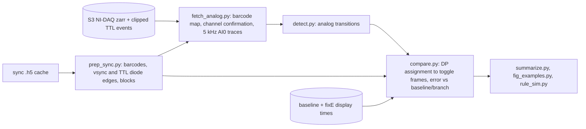
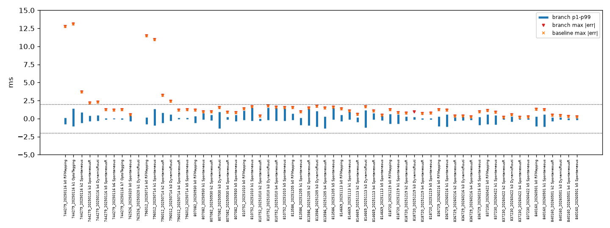
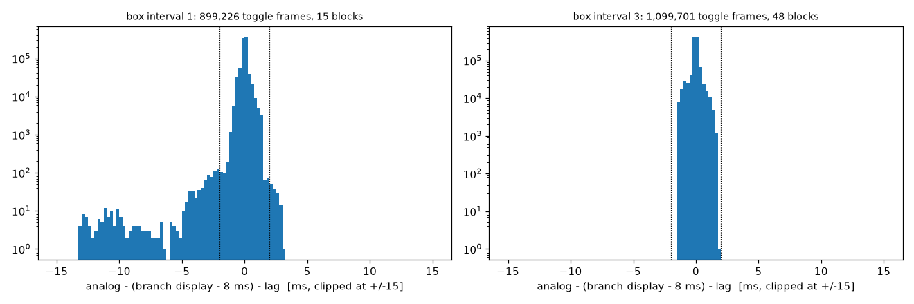
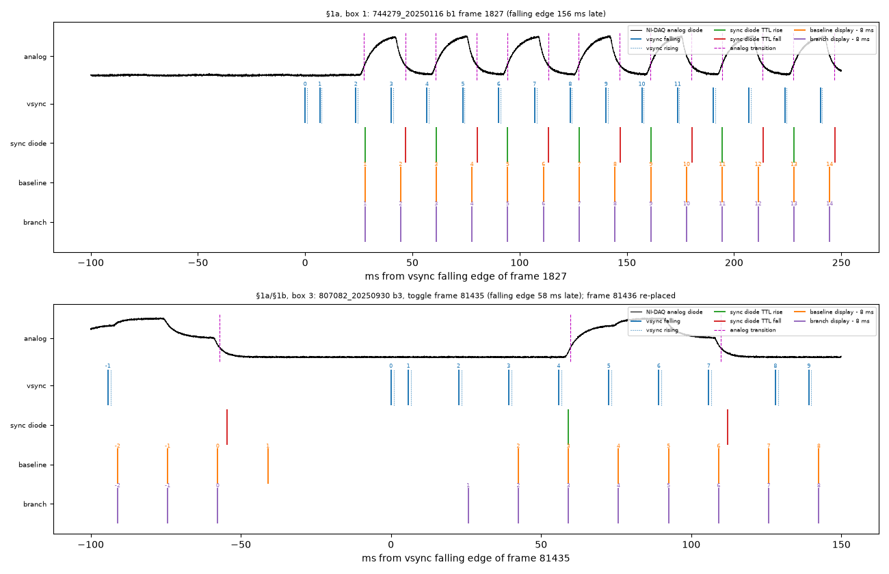
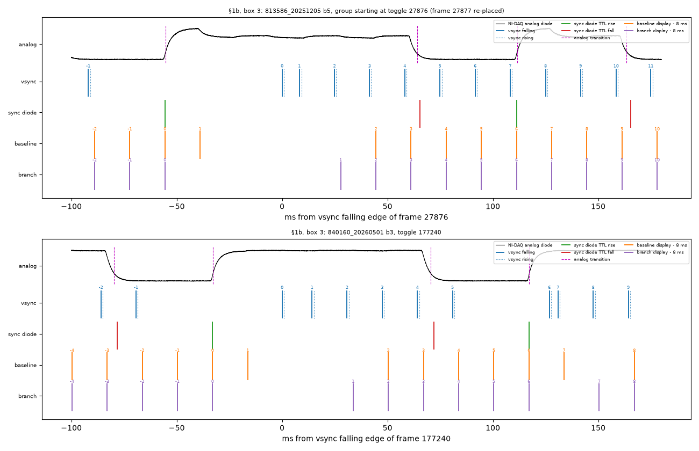
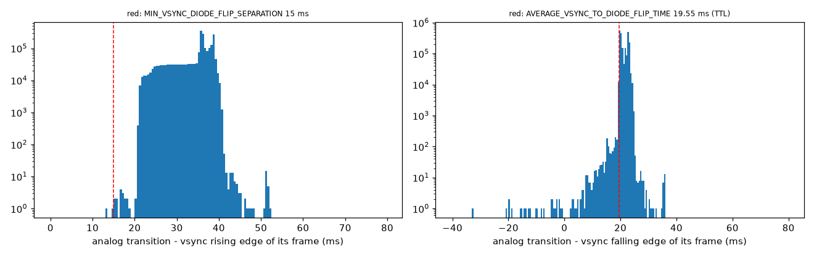
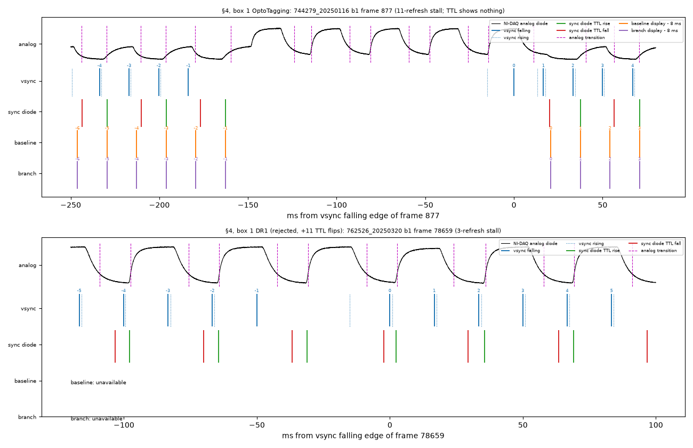
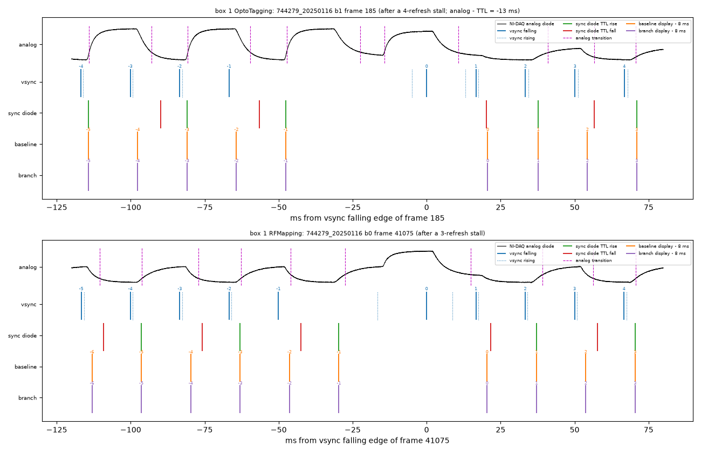
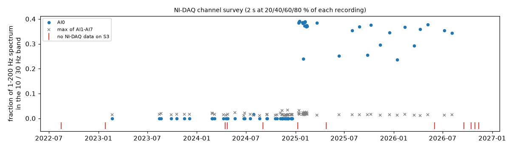

# Display times against the NI-DAQ analog photodiode (targeted P4)

2026-11-16 · Follows `notes/p4-analog-validation-handoff.md` and `outputs/display-times-issues.md`.
Code under test: npc_stim branch `display-times-p2-fixes` (worktree `C:/data/t2p_qc/wt/npc_stim_fix`, HEAD `cfae3e3`; **not pushed, not modified by this work**). The branch display times compared here are the `fixE` run (`64eccca`; `1431002`/`cfae3e3` change only a docstring and the dev-mouse-only flip-removal loop, which gave identical output on all other blocks, per `display-times-issues.md` §3). Baseline = `C:/data/t2p_qc/out/baseline` (byte-identical to the move branch).
Evidence: `experiments/display-times-analog-validation/` (scripts, logs, CSVs, `figs/`; see its README).

## Summary

- **The NI-DAQ only has the photodiode from January 2025.** I surveyed 87 sessions. AI0 is flat (it doesn't change) in all 42 sessions before 2025 that have NI-DAQ data, and no other channel has a photodiode-like signal either. From 2025-01-13 on, AI0 carries the photodiode in 33 of 33 sessions (Fig. 1). As a result, every handoff group from 2023–2024 is **blocked**: §2 (one frame late), the §1 hard-check rejects, §1a `702131`, §4 `699847`/`716718`, the §5 misalignment steps, and §5 `626791`. Two sessions are blocked because no NI-DAQ data were recorded or uploaded: `878903_20261028` and `867000_20261015`.
- **What I validated.** 11 sessions from 2025–2026 (64 blocks, 2,215,776 box toggles). In every block, AI0 was confirmed as the only channel whose transitions match the sync TTL diode edges in both directions (≥99.8 % of TTL edges matched, ≥97.9 % of AI0 transitions matched; the lowest is `744279` b1 with stall flicker). The analog clock was mapped to sync time through 138–249 shared barcodes, with fit residuals ≤0.08 ms. I assigned analog transitions to frames using only the analog trace, the vsync edges and the box polarity, so the assignment doesn't depend on the TTL diode line or on the estimator.
- **Box interval 3 passes.** 48 blocks, 1,099,701 toggles. Every toggle frame matched, the error is p1/p99 −1.21/+1.11 ms with max |err| 1.75 ms, and 0 toggles are assigned to the wrong diode edge. The baseline gives the same result.
- **Box interval 1 passes on assignment but has a timing tail.** 16 blocks, 899,226 toggles. The error is p1/p99 −0.73/+0.99 ms. 0 toggles are misassigned: none sits on another transition's TTL edge, and none is off by anywhere near a frame (max 13.1 ms against 16.7 ms). However, 935 toggles (0.10 %) are off by more than 2 ms, 114 by more than 8 ms, and the largest is 13.1 ms. They are all single frames right after a stall, mostly in the early blocks (RFMapping, OptoTagging) of two sessions, and baseline and branch are identical there. The cause is the shape of the analog waveform after a held white frame, not a misassigned flip (Fig. 6).
- **The §1b re-placement is consistent with the analog, but can't be checked frame by frame.** In the sample, the branch changes 20 frames, all inside a box group. The box doesn't change within a group, so the diode can't see those frames. The analog does show the following:
  - Every affected group really held for 3.8–7.2 refreshes.
  - Across 2.2 M toggles, no frame was displayed less than 20.9 ms after its frame signal went high (0.01st percentile). The 2 exceptions at 13–15 ms are a threshold artefact (see Calibration).
  - Baseline places 19 of the 20 frames earlier than that bound (9 of them before the rising edge), so those placements are physically implausible. The branch places all 20 frames 21.2–36.4 ms after the rising edge.
- **§1a is confirmed.** 33 toggle frames have a branch display time earlier than their own vsync falling edge, by up to 156 ms. The analog shows all 33 on time (|err| ≤2.2 ms, Fig. 3). So the falling edge is late; the display time isn't wrong.
- **The §5 recovery is right.** `818720_20251219` b3 (unavailable in baseline) has max |err| 0.93 ms and 0 misassigned toggles.
- **§4: the extra flips are real changes on the screen, not frames.** During stalls the screen keeps alternating at the refresh rate (Fig. 5):
  - In `744279_20250116` b1 (OptoTagging) there are 466 analog transitions that aren't frames. The TTL doesn't register them, so the block passes.
  - In `762526_20250320` b1 (DR1, rejected with +11 TTL flips) the analog shows exactly 11 non-frame transitions, at 3-refresh stalls.

  I tested the candidate rule ("keep the first flip in a long vsync interval") offline, and it is **not robust**. Depending on the window offset, it either drops 22–439 real frame flips or removes 6 of the 7 flicker edges that can be identified, and the block still ends up +5 over. **I didn't implement it.**
- **The branch is unchanged.** No fix failed validation, the §4 rule isn't supported, §5 segment re-alignment is blocked (there is no case in the analog era), and no constant needs recalibrating. The 15 ms minimum separation is conservative by about 6 ms. Analog minus vsync falling edge has a median of 20.70 ms, and the analog crossing is 0.2–3.4 ms after the TTL edge, which is consistent with the 19.55 ms prior (TTL). Because the code didn't change, I didn't re-run the population.
- **Paths not covered by the move QC** (on the branch, 442 cached sessions):
  - Path B (`get_stim_frame_times(..., "display_time")`) equals the branch path A for all 1,936 arrays.
  - Every difference from baseline in path B and in `stim_onsets`/`stim_offsets` is explained by the path-A changes, the move's `TypeError` fix, the move's designed `stim_offsets` fallback, or one cache change (dev mouse `366122_20250109`).
  - In two sessions, `DynamicRoutingSession` frame times are identical to the branch path-A output, and the trials tables build (507 and 541 trials).

### Pass criterion (≈1–2 ms, zero landmark shift)

| Group (handoff) | Sample with analog | Result | Status |
|---|---|---|---|
| §2 shifted one frame | none: all 2023-08 to 2024-04, AI0 flat or no NI-DAQ upload | – | **blocked** |
| §1 box-3 re-placed | 807082 b3, 813586 b0/b4/b5, 810752 b2, 814669 b0, 836729 b0/b2/b3, 837230 b0/b3/b5, 840160 b3 (20 frames); 878903 b0 blocked (no NI-DAQ recorded) | toggles: max 1.75 ms, 0 misassigned. Re-placed frames aren't observable on the box; baseline breaks the empirical latency bound in 19/20, branch in 0/20 | **pass for what's observable**; placement only shown to be plausible |
| §1a late falling edge | 744279 b1 f1827; 32 more toggles in 9 sessions; 702131 blocked | all on time: \|err\| ≤2.2 ms, up to 156 ms before the falling edge | **pass** (cause (a) confirmed) |
| §1 hard-check rejects | 733891, 742903, 714748: all 2024 | – | **blocked** |
| §4 extra flips in stalls | 699847/716718 blocked; substitute 762526_20250320 b1 (DR1), plus 744279 b1/b7 (OptoTagging, accepted) | the extra TTL flips are real alternation of the screen; the rule isn't robust | **mechanism shown; fix not implemented** |
| §5 misalignment steps | 733891_0917, 761583: 2024 | – | **blocked** |
| §5 recovered | 818720 b3 (626791 blocked: no S3 upload) | max 0.93 ms, 0 misassigned | **pass** |
| clean controls | 49 unchanged blocks in the 11 sessions (2025-01 to 2026-05; box 1 and box 3) | box 3 max 1.75 ms; box 1 p99 ≤1 ms with the after-stall tail | **pass**; box-1 tail is open |

## Data and sample



- **Where the analog is.** Continuous NI-DAQ data have been removed from the share; only TTL events remain, except for `744279_20250116` and `761583_20241219`. The compressed zarrs are on S3 in `aind-ephys-data`, `aind-private-data-prod-o5171v` or `aind-open-data`, as `ecephys[/ecephys]_compressed/experimentN_Record Node M#NI-DAQmx-*.PXI-6133.zarr`. They are found by session start time (`locate.py`).
  - `878903_20261028`: its share folder has NI-DAQ TTL events but no continuous NI-DAQ stream, and nothing on S3.
  - 12 of the 87 surveyed sessions have no NI-DAQ data on S3: 9 have no upload within 10 min of the sync start (including `626791_20220816`, `867000_20261015` and `878903_20261028`), and 3 have an upload without an NI-DAQ zarr (`699847_20240415`, `706401_20240423`, `736208_20240903`).
- **Channel survey** (`survey_channels.py`, `survey_summary.log`, Fig. 1). Across 2023-02 to 2024-12 (42 sessions), AI0 has a peak-to-peak range of 0 counts (it is constant) and no channel exceeds 0.034 band fraction. From 2025-01-13 on, AI0's 10 Hz (box 3) or 30 Hz (box 1) band fraction is 0.24–0.39. Four 2025+ sessions have one low-swing 2 s window, which presumably falls between blocks. The survey is only a screen. The channel was **confirmed** for the analysed sessions only.
- **Analysed sessions:** `744279_20250116`, `762526_20250320`, `796012_20250714` (box 1); `807082_20250930`, `810752_20251010`, `814669_20251113`, `813586_20251205`, `818720_20251219`, `836729_20260216`, `837230_20260422`, `840160_20260501` (box 3). That gives 11 sessions, 64 blocks and 63 blocks with branch display times.
  - The six added beyond the handoff list either have §1-changed or §1a frames, or are 2026 controls.
  - The handoff's §4 examples are pre-2025, so `762526_20250320` b1 is the only §4-rejected block from the analog era (`flip_count.csv`).

## Method

1. **Clock mapping.**
   - Barcodes come from the NI-DAQ TTL line that best matches the sync `barcode_ephys` barcodes (line 1 in all 11 sessions).
   - The map is piecewise linear between shared barcodes. Each session has 138–249 shared barcodes, a global linear-fit residual of −0.08 to +0.08 ms, and a largest step between consecutive barcodes of ≤0.04 ms.
   - Sample numbers are contiguous in all 11 sessions (`analog.json`).
2. **Channel confirmation** (`fetch_analog.py`, `channel_confirmation.log`).
   - For each block, I took a 30 s window at the block's midpoint and detected transitions on all 8 channels.
   - A channel counts as confirmed for a block if ≥95 % of the sync TTL diode edges have a transition within −5/+12 ms of them, **and** ≥95 % of the channel's transitions have a TTL edge.
   - AI0 was the only channel confirmed, in every block of every session (TTL side ≥0.998, AI0 side ≥0.979). No other channel met both criteria in any block. AI3 (a dense, noisy channel) reaches up to 0.80 of the TTL edges but at most 0.81 of its own transitions.
3. **Detection** (`detect.py`).
   - The 30 kHz trace is averaged to 5 kHz. Transitions are found with a Schmitt trigger at 0.5/0.15 of the local swing and timed at the 0.25 crossing.
   - The local swing is the min/max over 80 ms. Two exceptions: inside long white phases the 5 s black level is used, and in flat stretches the 5 s levels are used.
   - Local levels are needed for three reasons. The white level changes abruptly (380 ↔ 1,250 counts in OptoTagging). With box interval 1 the trace doesn't settle to black between toggles. And the first refreshes after black→white overshoot the steady white level.
   - Two earlier, global-level versions of the detector missed transitions in those regimes (`figs/scratch/`). The final counts equal the vsync / N count in every block except where stall flicker adds transitions.
4. **Ground truth** (`compare.py::assign_dp`): a monotone alignment of analog transitions to the block's toggle frames (f % N = 0).
   - The match cost is min(|a − vf[f] − Lf|, |a − vr[f] − Lr|), where vf is the falling edge and vr the rising edge. The second term is for falling edges delayed by a stall after `flip()`.
   - A toggle must have the polarity p0·(−1)^i.
   - Leaving a frame or a transition unmatched costs 12 ms. Lf and Lr are the block's own medians, from a second pass.
   - No TTL diode edges and no display times are used. Cross-check: an ordinal assignment, with its offset chosen by dropped-refresh landmarks, agrees with the DP in every block except `762526` b1, where flicker breaks ordinal counting.
5. **Error.** r = analog(f) − (display(f) − 8 ms), and err = r − lag(polarity). The lag is the session median of r for that polarity: the analog 0.25 crossing is 0.20–0.46 ms after the TTL edge for rising transitions and 1.50–3.41 ms after it for falling ones.
   - A flip assigned to the wrong frame by j frames would show up as err ≈ j·16.7 ms.
   - "Misassigned" is counted directly: the display time of a toggle equals a raw TTL edge other than the one nearest its analog transition (`*_n_edge_shifted`, `*_gt4_other_edge`). I use this as the landmark test because diode phase can't show shifts that are a multiple of N.

## Results

### Accuracy at box toggles

| Box | Blocks | Toggles | p1 / p99 (ms) | p99.9 \|err\| | max \|err\| | >2 ms | >8 ms | misassigned (baseline / branch) |
|---|--:|--:|--:|--:|--:|--:|--:|--:|
| 3 | 48 | 1,099,701 | −1.21 / +1.11 | 1.50 | 1.75 | 0 | 0 | 0 / 0 |
| 1 | 16 (15 with display times) | 899,226 | −0.73 / +0.99 | 2.06 | 13.11 | 935 (0.10 %) | 114 | 0 / 0 |

Source: `summary.log` and `results_blocks.csv`. The per-block p1/p99/max are in Fig. 2. Baseline and branch are identical at every toggle in the 62 blocks that have both. The 818720 b3 row is branch-only.


*Figure 2. Per block: branch p1–p99 (bars), branch max |err| (▼) and baseline max |err| (×); dotted lines at ±2 ms.*


*Figure 2b. Pooled error distributions (branch), box interval 1 (left) and 3 (right), on a log scale.*

**Box-1 tail.**
- Location: all 935 frames over 2 ms are in `744279_20250116` b0–b4 and `796012_20250714` b0–b3. Of those, 517 are in RFMapping and 186 in OptoTagging. The last two (`796012`) or three (`744279`) blocks of each session have none.
- Error type: of the 240 frames over 4 ms, 37 sit on their own raw TTL edge and 203 on a flip moved by `adjust_diode_flip_intervals`. That function shifts every other flip by a constant, to undo the asymmetric thresholding. None is on another frame's edge.
- Timing: each is the first frame after a held white phase (a stall). The analog fall is slow and has two stages, and the TTL comparator fires near its end, up to 13 ms after the 0.25 crossing (Fig. 6).
- Trend: in `744279` b1 the deviation shrinks from −13 to −5 ms over about 3 minutes, and the late blocks show none. That pattern suggests a property of the monitor that drifts with warm-up. This is **an inference**; I didn't test it.
- Interpretation: it's a limit of TTL thresholding that baseline and branch share, not a frame-assignment error. Which crossing is the "true" display time for these frames is a definitional question (see Open questions).

### §1a: display before the vsync falling edge

33 toggle frames (and 1 non-toggle) have a branch display time minus 8 ms earlier than their vsync falling edge. Their analog transitions are 153 ms before to 3 ms after the falling edge, and |err| is at most 2.2 ms (median 0.07). So the display is on time and the falling edge is late. That is cause (a) in `display-times-issues.md`, now confirmed against an independent signal (`results_late_fall.csv`). The "frames displayed before vsync" metric in the move QC should therefore be replaced (done: see Docs updated).


*Figure 3. Top: `744279_20250116` b1 frame 1827. Its frame signal falls 156 ms late, but the analog box flip is on the normal cadence and matches the display times. Bottom: `807082_20250930` b3. Toggle 81435 has a falling edge 58 ms late. The next frame, 81436, is placed by baseline at −42 ms from its own rising edge, and by the branch after its rising edge.*

### §1b: re-placed frames inside a box-3 group

| | Baseline | Branch |
|---|--:|--:|
| changed frames (all non-toggle) | 20 | 20 |
| display − 8 ms − own vsync rising edge: min | −42.0 ms | +21.2 ms |
| frames below the analog-calibrated bound (rise + 20.9 ms) | 19 | 0 |
| frames below rise + 15 ms / before the rising edge | 18 / 9 | 0 / 0 |

Source: `results_changed_frames.csv`.
- **Groups.** Every group with a changed frame lasts 3.81–7.16 refreshes on the analog. So refreshes really were dropped, and one or more of the group's frames was held.
- **Slots.** Baseline puts the changed frame about 1 refresh after the group's toggle; the branch puts it 2–5 refreshes after (`base_slot`/`fix_slot`).
- **Which frame was held isn't visible on the box.** The first and last toggle of each group are correct in both versions.
- **One undecidable case.** `814669_20251113` b0 frame 48607 is moved by the branch from a plausible slot (52 ms after its rising edge) to another plausible slot (36 ms), as a side effect of re-placing its neighbour 48608.


*Figure 4. Two re-placed groups. The analog toggles bound each group. In both, baseline puts frame +1 before its frame signal went high (−40 ms and −17 ms); the branch puts it 27 ms and 33 ms after.*

### Calibration of the constants


*Figure 7. Time from a toggle frame's vsync rising edge (left) and falling edge (right) to its analog transition, for all 2.2 M checked toggles.*

- **From the rising edge.** Median 35.9 ms (block medians 30.6–36.7 ms; the frame-signal pulse is 9.7–15.9 ms wide depending on rig). The 0.01st percentile is 20.9 ms and the 0.1st is 21.2 ms.
  - Only 2 toggles are under 15 ms, at 13.2 and 14.6 ms. Both are after-stall frames in `744279` b1, where the analog crossing is 13 ms ahead of the TTL edge. On the TTL, the same frames are at least 26 ms after the rising edge.
  - `MIN_VSYNC_DIODE_FLIP_SEPARATION_SEC` = 15 ms is therefore safe, with about 6 ms margin, for the hard check and for placement. **No change.** Tightening it to about 20 ms would be supported by these 11 sessions, but not by pre-2025 data (blocked).
- **From the falling edge.** Median 20.70 ms (p1 19.56, p99 23.72). The analog crossing lags the TTL by 0.2–3.4 ms, so TTL minus falling edge is about 17–20.5 ms, consistent with `AVERAGE_VSYNC_TO_DIODE_FLIP_TIME` = 19.55 ms. That constant is only a prior, for the ½-frame tests and for placement. **No change.**

### §4: what the extra flips in stalls are


*Figure 5. Top: `744279_20250116` b1 (OptoTagging), an 11-refresh stall before frame 877. The analog keeps alternating between bright (~1,150 counts) and near-dark (~70; true black is −134) at half the refresh rate. None of it crosses the TTL threshold. Bottom: `762526_20250320` b1 (DR1), a 3-refresh stall. The box keeps toggling every refresh through the stall, exactly as if frames were being presented, and the TTL registers the toggles. `frameIntervals` in the stim file also shows a 3-refresh interval.*

- **The extra TTL flips are real light.** They aren't a comparator glitch, and they aren't frames.
  - In `762526` b1, the DP finds 216,849 frame transitions (equal to the vsync count) plus 11 analog transitions that aren't frames. That matches the TTL excess of +11 (`compare_all.log`).
  - These 11 sit at 5 stalls (2 each) and at the end of the block.
  - The alternation looks like the display re-presenting the previous buffer on each missed refresh. That mechanism is **an inference**; I didn't check it against the driver or PsychoPy.
- **During such a stall, frame identity can't be recovered from the box.** In box 1, consecutive buffers have opposite box colours, so the alternation is photometrically identical to new frames. The DP decides only through vsync latency and polarity, and after the stall frames resume at normal latency (e.g. frame 78659: +23.9 ms after its falling edge).
- **The candidate rule is fragile.** `rule_sim.py` (`rule_sim.log`) labels each TTL edge by its nearest analog transition: frame, flicker, or none. Because the labels depend on the analog DP, this test is only semi-independent.
  - Window = falling edge + 8 ms, intervals ≥1.5 refreshes: the rule drops 73 real frame flips in `762526` b1, 43–160 in OptoTagging blocks that were fine, and 439 in `796012` b3.
  - Window offset 16 ms: it drops 0 frame flips and 6 of the 7 flicker-labelled flips. `762526` b1 then ends at +5, which is exactly at the ±5 tolerance.
  - Dropping only pairs (to keep polarity) removes nothing in `762526` b1.
  - So the outcome depends on a tuning constant, and only one rejected block exists in the analog era. **I didn't implement the rule or any §5 re-alignment.** The rejection stays.

### After-stall timing deviations (box 1)


*Figure 6. After a held white phase, the fall to black is slow and has two stages. The TTL fires near the end of the fall; the analog 0.25 crossing comes earlier. Analog − TTL is −13 ms (top) and −9 ms (bottom). Both versions use the same TTL edge for the frame.*

### Channel survey


*Figure 1. AI0 band fraction (10/30 Hz) by session date. Before 2025 it is flat; from 2025-01-13 the photodiode is present. Red ticks: no NI-DAQ data on S3.*

## Path B, stim_offsets and an end-to-end Session

- **Path B, A2 and D on the branch.** I ran `qc_run.py fixE_qc` on 442 cached sessions; 2 of the 444 aren't cached. Output is in `C:/data/t2p_qc/out_issues/fixE_qc`; the comparison is `compare_pathB.py` → `compare_pathB.log/.csv`.
  - **Internal consistency.** Each of the 1,936 path-B arrays (`get_stim_frame_times(..., "display_time")`) is identical to the path-A array of its matched block. Path B returns no times where A has none. The A2 shim equals A everywhere.
  - **Against baseline, every difference is explained:**
    - 154 arrays changed, all in blocks whose path A changed (`compare_fixE.csv`).
    - 4 arrays became `ValueError`. These are the 4 blocks that went photodiode → unavailable (`702131_20240227` b5, `714748_20240624` b4, `733891_20240918` b4, `742903_20241024` b4).
    - 170 arrays are new. All are in the 35 sessions where baseline path B crashed with `TypeError` (the move's fix; 12 of them are also in A-changed blocks).
  - **Session-level path-B errors** go from 104 (66 `AssertionError`, 35 `TypeError`, 3 `IndexError`) to 69 (67 `AssertionError`, 2 `IndexError`):
    - The `TypeError`s are the move fix.
    - The `IndexError` in `796848_20250715` is the `64eccca` fix.
    - The one new `AssertionError` is `366122_20250109`. That session now selects its other sync file, `20250109T194446.h5`, because the local copy of the larger one was deleted (`display-times-issues.md` §3). The new file contains replayed data and is rejected. That is a cache change, not a code change.
  - **`stim_onsets`/`stim_offsets`.** They are unchanged except in `626791_20220815/16/17` (the move's designed fallback for files with no stim_running line, already in the move QC) and `366122_20250109` (the sync file change above).
- **`DynamicRoutingSession` end to end** (`session_e2e.py`, `session_e2e.log`; npc_sessions `0ec6d59`, `.venv` with PYTHONPATH set to the branch npc_stim and the dev npc_sync `59aaf91`).
  - For `807082_20250930` (6 stims) and `744279_20250116` (8 stims), every stim has `source=photodiode`, its matched block, and display times identical to the branch path-A output.
  - `trials` builds: 507 and 541 rows, 49 columns, 0 NaN in `start_time`/`stim_start_time`.
  - Side observation: npc_sessions makes a second display-time call with only the task stim. The other blocks then log "no stim file matched to block". The times are correct, but the call duplicates work and produces log noise. Not investigated.
- **Tests on the branch HEAD `cfae3e3`** (`pytest_cfae3e3.log`): `tests/test_display_times.py` gives 7 passed, 1 xfailed, with `test_slow_processing_file` deselected. The module doctests give 4 passed. There are fewer tests than the 18 reported at `1431002`, because `cfae3e3` removed the 2 linear-time-removal tests and their doctests.

## Disagreements, caveats

- **Timing reference.** "err" is measured against the analog 0.25-of-swing crossing, less a per-session, per-polarity constant. A different threshold moves the after-stall frames by several ms (Fig. 6). The sub-2 ms agreement elsewhere is robust to this, because the waveform shape is then constant.
- **Independence.** The ground truth uses analog plus vsync edges plus box polarity. It shares the assumption with the estimator that frames follow vsync with a roughly constant latency, and the DP's latency medians come from the same block. Toggle misassignment is tested without the estimator. The §4 rule test is only semi-independent.
- **Coverage.** All analog-era sessions are 2025-01 or later, so every finding is limited to those rigs and that period. Box-3 coverage is 2025-09 to 2026-05; box-1 coverage is 2025-01 to 2025-07.
- **Not observable.** Display times of non-toggle frames in box-3 blocks, about ⅔ of all frames there, can't be checked against the diode. Only the bounds are checked.
- **The handoff's pointer** to "`lost_events.log` D1 compared rebuilt vsyncs with the analog photodiode" points to the wrong place. That analog work is in `../npc_sync/experiments/vsync-frame-count/analog_diode.py` and `analog_vs_stim.py` (6 sessions, 2026). I reused its barcode approach and its `npc_ephys_barcodes.py`, and copied the latter here.

## Open questions

1. Can box-3 placement be checked another way? Small luminance steps inside a white phase (Fig. 4, top) might mark frame updates. **Not tested.**
2. For box-1 after-stall frames, is the "display time" the start of the fall or the TTL crossing? This matters only for analyses that need better than 10 ms timing at stall boundaries.
3. Can §4 blocks be recovered with a monotone alignment of the TTL edges (the DP used here, on TTL), instead of the window rule? Each stall stays ambiguous by ±2 frames, as described above. This needs more rejected blocks from the analog era than the one that exists.
4. Does the pre-2025 data have the photodiode recorded anywhere else, for example a different NI device or a second record node? Only the first record node's zarr was surveyed; a second one was listed in some sessions.

## Next steps

1. Release order (user decision): npc_sync 0.3.0 → npc_stim move branch → `display-times-p2-fixes` (rebase and push) → locks. There are no branch changes from this validation.
2. P2 leftovers, unchanged: exact one-to-one stim matcher (§6), clear npc_sync errors (§7), a replacement file for the xfail test (§8), removing end truncation. Possibly also deduplicate the task-stim display-time call in npc_sessions.
3. Full P4 rollout (plan), for the analog era only: run `fetch_analog.py`, `compare.py` and `summarize.py` on every session from 2025 onward with an NI-DAQ upload. Treat 2023–2024 as permanently unverifiable against the analog.

## Reproduce

```
cd experiments/display-times-analog-validation
C:/data/t2p_qc/venv_new/Scripts/python prep_sync.py <folders...>         # sync side (npc_sync dev)
C:/data/t2p_qc/venv_analog/Scripts/python fetch_analog.py <folders...>   # S3 -> traces (+ detect)
./run_all.sh                                                              # detect + compare, 11 sessions -> compare_all.log
C:/data/t2p_qc/venv_analog/Scripts/python summarize.py > summary.log
C:/data/t2p_qc/venv_analog/Scripts/python fig_examples.py
C:/data/t2p_qc/venv_analog/Scripts/python rule_sim.py <folder> <block> --grid
C:/data/t2p_qc/venv_analog/Scripts/python survey_channels.py $(cat survey_sessions_all.txt)
```
`venv_analog` = Python 3.11 with numpy, zarr<3, numcodecs, wavpack-numcodecs, s3fs, boto3, h5py, scipy, pandas, matplotlib (created for this work). It needs AWS credentials for the three buckets.

## Sources

- Handoff and context: `notes/p4-analog-validation-handoff.md`, `outputs/display-times-issues.md`, `outputs/display-times-move-qc.md`, `outputs/sync-frame-timing-upgrade-plan.md` (P4, open questions).
- Prior analog code: `../npc_sync/experiments/vsync-frame-count/analog_diode.py`, `analog_vs_stim.py`, `npc_ephys_barcodes.py`; `../npc_sync/outputs/vsync-frame-count-discrepancies.md` §2.3.
- Code: npc_stim `display-times-p2-fixes` @ `cfae3e3` (`src/npc_stim/display_times.py`: `MIN_VSYNC_DIODE_FLIP_SEPARATION_SEC`, `AVERAGE_VSYNC_TO_DIODE_FLIP_TIME`, `adjust_diode_flip_intervals`); npc_sessions `0ec6d59` (`sessions.py` `_stim_display_times`).
- Data: NI-DAQ zarr and clipped events on S3 (`aind-ephys-data`, `aind-private-data-prod-o5171v`, `aind-open-data`; per-session paths in `C:/data/t2p_qc/analog/<folder>/analog.json`); sync and stim files in `C:/data/t2p_cache`; display times in `C:/data/t2p_qc/out/baseline`, `C:/data/t2p_qc/out_issues/fixE`, `C:/data/t2p_qc/out_issues/fixE_qc`.
- Artifacts: `experiments/display-times-analog-validation/` (README lists every log and CSV).
