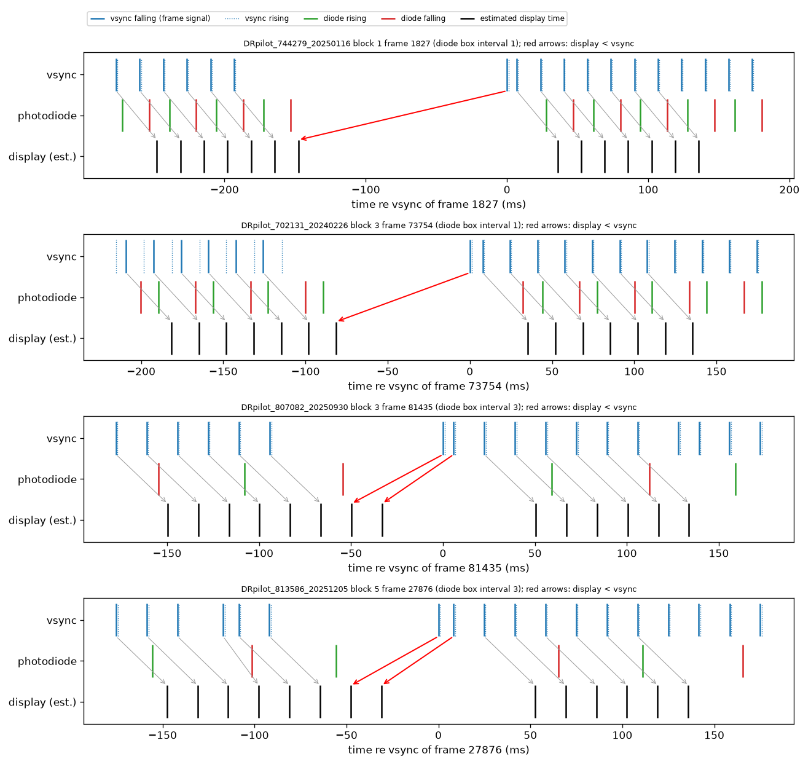
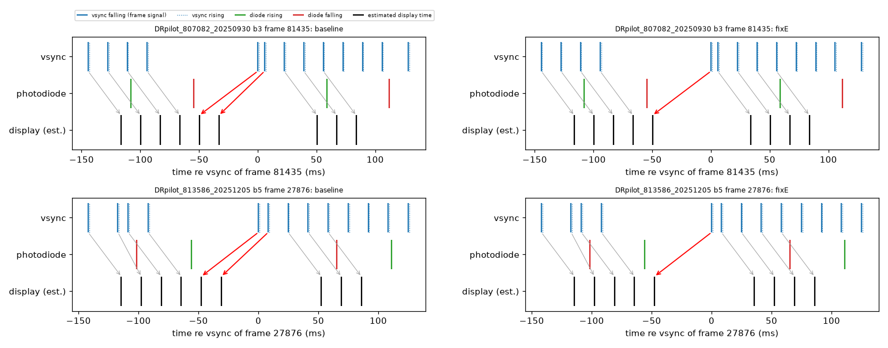
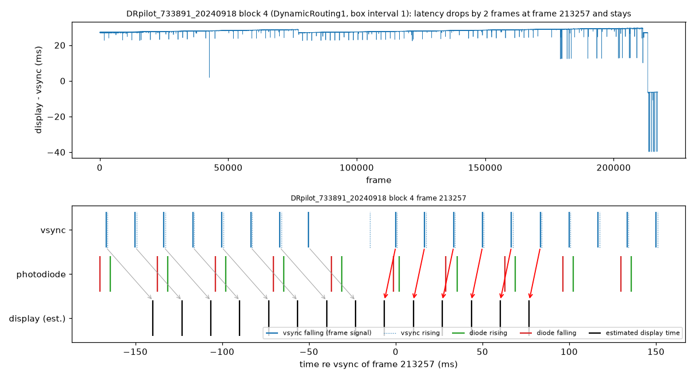
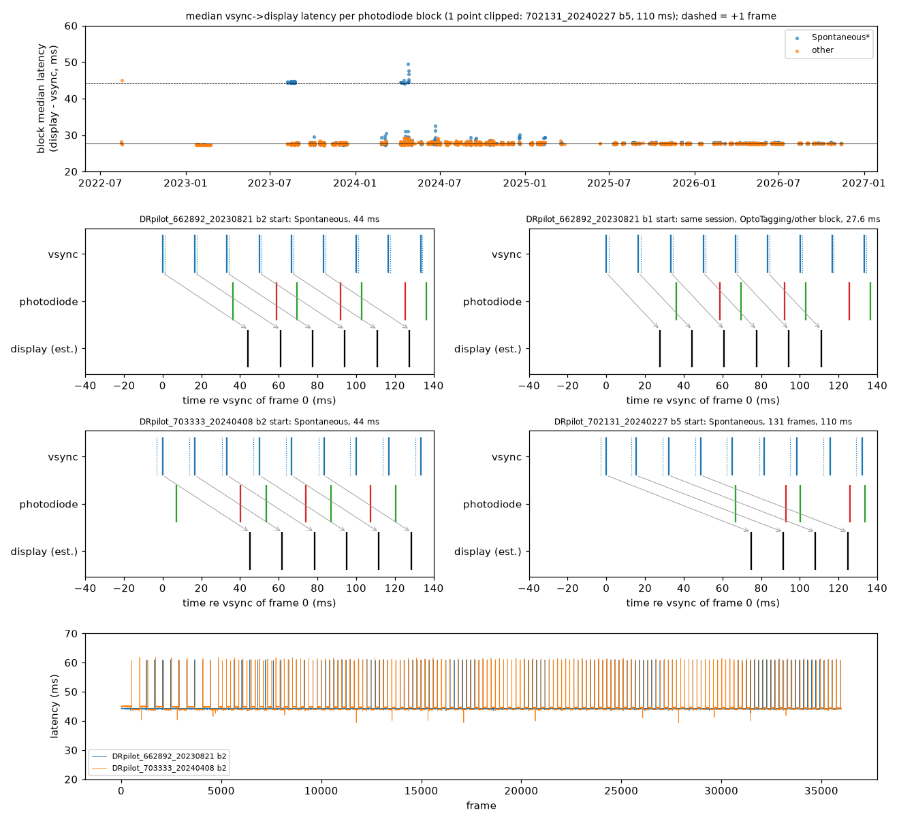
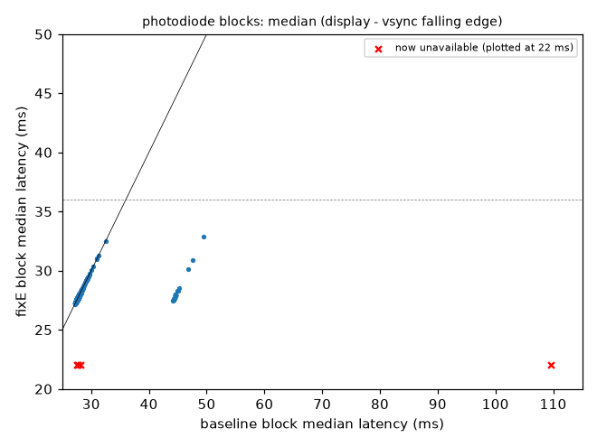
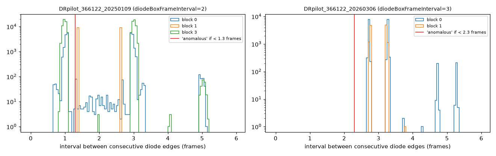
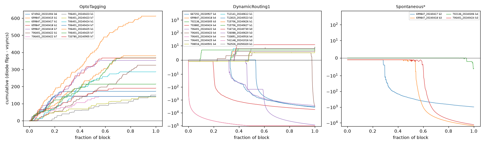
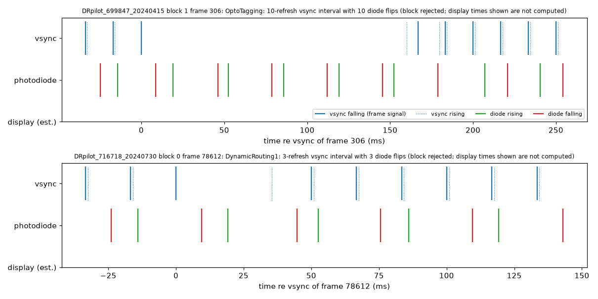
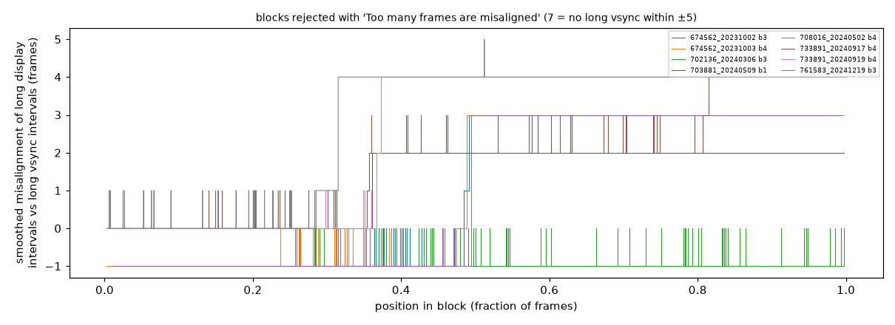
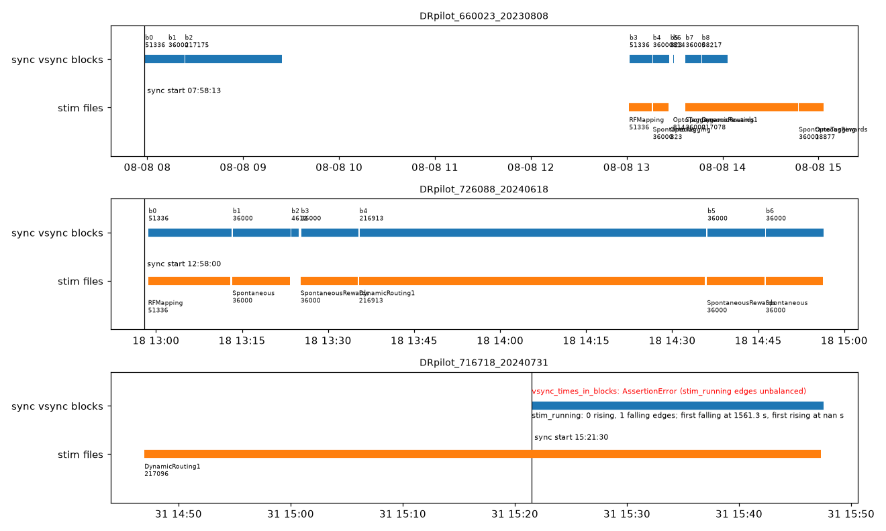

# Display-time estimation: causes and fixes for the pre-existing issues

2026-11-15 · Follows `outputs/display-times-move-qc.md` (section "Pre-existing issues" and the blocked/unavailable tables).
Code: npc_stim branch **`display-times-p2-fixes`** (6 commits on `move-display-times-to-npc-stim` @ `960f282`; local worktree `C:/data/t2p_qc/wt/npc_stim_fix`). **Not pushed.** The `../npc_stim` working tree is untouched.
Evidence: `experiments/display-times-issues/` (scripts, logs, CSVs, `figs/`; see its README). Population: the same 442 cached Task 2 pilot sessions with sync files as the move QC.

## Summary

| # | Issue (baseline) | Cause | Status |
|---|---|---|---|
| 1 | 4,065 frames in 169 blocks displayed "before their vsync" | Three causes. **(a)** 148 frames: the vsync *falling* edge is late, because the script stalled after `flip()` returned; the display time is right. **(b)** 88 frames (87 with box interval 3): the dropped-refresh placement inside a diode interval is wrong because it trusts the late falling edges. **(c)** 3,829 frames in one block: two extra diode flips in the middle of the block, hidden by the end-of-block truncation | **Fixed** (b) using the vsync rising edge as a lower bound. **New hard check** rejects anything that still violates that bound, which catches (c) and 2 other blocks. (a) is not an error |
| 2 | 39 blocks with a median latency over 35 ms | The first diode flip of the block was missed, so the whole block is 1 frame late. The correction for this is skipped for Spontaneous* stims | **Fixed**: 38 blocks corrected from their median latency (all now 27.2–32.8 ms); 1 rejected (5 frames off) |
| 3 | `366122_20250109` runs for >30 min | Box interval 2 plus asymmetric diode thresholding put about 50% of intervals under the "anomalous" threshold. Removal was O(n²). Once removal finished, a block with 99.9% of its flips gone would have been returned as `photodiode`, with its times invented | **Fixed**: linear-time removal (identical results on 1,987 blocks), plus a flip-count check for box interval > 1. The session now takes 11 s and all 6 blocks are `unavailable` with reasons |
| 4 | 36 blocks rejected by the flip-count check (±5) | 11 blocks: the diode signal is lost for long stretches. 25 blocks: extra flips appear during long vsync intervals (stalls), only in those blocks | Explained, **not fixed**. The rejection is correct. The mechanism behind the extra flips is unclear |
| 5 | 12 blocks where the estimator failed | 8: misalignment accumulates in steps of +2 to +4 frames mid-block. 2: borderline first-frame latency. 1: allocation assertion when there are more long vsync intervals than dropped refreshes. 1: vsync jitter counted as dropped frames | **Fixed 2** (recovered, latency normal); **10 explained** |
| 6 | 13 blocks with no stim file, 1 block with vsync count ≠ stim frames | The stim files aren't in the session folder (aborted runs, a morning session on the same sync file, folders with no stim files). One sync file is truncated and the lax matcher assigned the wrong file | Explained. Data or matcher (P2), not the estimator |
| 7 | Session-level crashes: 3 `IndexError`, 1 `AssertionError` | No vsync edges (2). No photodiode edges at all (1). Sync started 35 min after the stim (1) | **Fixed 1** (the no-photodiode session now returns `unavailable` blocks); 3 explained |
| 8 | `test_missing_diode_flips_at_start_of_block` checked nothing | An exception raised in its thread was swallowed. The file now fails replay detection | **Fixed** (the exception is re-raised); the test is a strict `xfail` until the file is replaced |

**Net effect on the 2,000 blocks** (baseline → final branch, `compare_fixE.csv`): 1,830 identical; 164 with changed times; 4 photodiode → unavailable; 2 unavailable → photodiode. Photodiode blocks go from 1,938 to 1,936. The block median latency range goes from 27.17–109.66 ms to 27.17–32.84 ms. Frames displayed less than 15 ms after their vsync rising edge go from 3,941 (78 blocks) to 0. 148 frames still have display < vsync *falling* edge. All of them are displayed ≥23 ms after their rising edge, which is consistent with a late falling edge (cause 1a).

| Check (all 442 sessions) | baseline | fixB `a4160d8` | fixC `6b90a52` | fixD `42f39a3` | **fixE `64eccca`** |
|---|--:|--:|--:|--:|--:|
| photodiode blocks | 1,938 | 1,937 | 1,937 | 1,939 | **1,936** |
| blocks with median latency > 35 ms | 39 | 0 | 0 | 0 | **0** |
| frames with display < vsync falling edge (blocks) | 4,065 (169) | n/m | 3,979 (130) | 3,979 (130) | **148 (127)** |
| frames with display < rising edge + 15 ms (blocks) | 3,941 (78) | n/m | 3,830 (2) | 3,830 (2) | **0 (0)** |
| frames with diode flip < rising edge + 15 ms (blocks) | n/m | n/m | 3,831 (3) | 3,831 (3) | **0 (0)** |
| sessions that time out or crash in the estimator | 1 + 1 | 0 + 1 | 0 + 1 | 0 + 1 | **0 + 0** |

n/m = not measured. Sources: `eval_rise.log`, `compare_fix{B,C,D,E}.log`. "Display" includes `MONITOR_CENTER_REFRESH_TIME` (8 ms), so "diode flip < rising + 15 ms" means "display < rising + 23 ms". The crash count excludes the sync-level rejections (64 replayed, 2 discontinuities, 2 with no vsync edges, 1 with unbalanced stim_running), which are identical in every run.

## Branch `display-times-p2-fixes` (npc_stim)

| Commit | Change | Blocks affected (all 442 sessions) |
|---|---|---|
| `1777bce` | `remove_anomalous_diode_flips`: linear-time, same results as the old loop. The ±5 flip-count check now also applies when `diodeBoxFrameInterval` > 1. The test re-raises the thread exception (strict xfail) | only `366122_20250109` (hang → 6 × unavailable) |
| `a4160d8` | `correct_whole_block_frame_offset`: block median vsync→flip latency within ½ frame of 19.55 ms → unchanged; +1 frame → insert the first frame and drop the last; anything else → unavailable | 38 corrected, 1 rejected |
| `6b90a52` | `get_vsync_rising_edges`, `place_frames_in_diode_interval`: if the existing placement inside a box-N interval puts a frame before rising edge + 15 ms, that group is re-placed | 126 box-3 blocks, 280 frames, max change 66.7 ms |
| `42f39a3` | Box-N groups with more long vsync intervals than dropped refreshes are placed, not rejected. The "few long intervals" check counts vsync intervals over 1.5 frames, not 1.1 | 2 recovered |
| `64eccca` | Hard check: any diode flip < rising edge + 15 ms → unavailable (replaces the disabled `display ≥ vsync` assert). A block with no diode edges → unavailable, not a session `IndexError` | 3 rejected; 1 session no longer crashes |
| `1431002` | docstring only | – |
| `cfae3e3` | **reverts** the linear-time removal and its 2 tests (keeps the N > 1 flip-count check and the test thread fix) | `366122_20250109` hangs again (dev mouse, not analysed) |

Tests: `pytest tests/test_display_times.py` plus the module doctests give **18 passed, 1 xfailed** (`test_slow_processing_file` deselected for time; the S3 tests ran because credentials worked on 2026-11-15). The new tests:
- `test_remove_anomalous_diode_flips_matches_original_loop` (5 seeds × 200 synthetic trains, compared against the old loop)
- `test_remove_anomalous_diode_flips_is_fast` (50k-flip box-2 train)
- doctests for the new functions

---

## 1. Frames "displayed before their vsync"

**Observation.** In baseline, 4,065 frames in 169 photodiode blocks have an estimated display time earlier than the vsync falling edge of the same frame. One block, `733891_20240918` b4, accounts for 3,829 of them. Of the other 236, the median is 1 per block.

**Cause (a): the vsync falling edge is late; the display time is correct.** TaskControl's `showFrame` raises the frame signal *before* drawing and calling `flip()`, and lowers it *after* `flip()` returns (`DynamicRoutingTask/TaskControl.py` L394–416). The estimator uses only the falling edge as "the vsync". If the script stalls between `flip()` returning and `write(False)`, the falling edge is late but the frame is on screen on time. Figure 1 (top) shows a case: frame 1827 of `744279_20250116` b1 was flipped at the regular time, and its diode flip is 21 ms after the previous frame's. But its frame-signal falling edge (and the next frame's rising edge) came 176 ms later. The signature is a long frame-signal pulse (rising → falling > 25 ms) followed by a falling-edge interval shorter than 1 frame.
- 148 of the 236 frames (in 127 blocks) are consistent with this: their display is ≥15 ms after their own rising edge, and every one of them has a pulse > 25 ms (`neg_classify.log`).
- Long pulses are common: 966 of 1,938 photodiode blocks have at least one (2,502 frames; `vsync_rise_check.log`).

**Cause (b): frames placed wrongly inside a box-3 diode interval.** With `diodeBoxFrameInterval` = 3, a diode interval that spans more than 3 refreshes has "dropped" refreshes. The estimator decides which frame was held longer by looking for long *falling-edge* intervals. A late falling edge makes that choice wrong, so the next frame is placed before it was even drawn. Figure 1 (bottom two) and Figure 2 (left) show `807082_20250930` frame 81436 placed 39 ms before its frame signal went high. 88 negative-latency frames are physically impossible in this sense (display < rising edge + 15 ms), and 87 of them are in box-3 blocks.

**Cause (c): two extra diode flips mid-block, hidden by end truncation.** In `733891_20240918` b4 (Figure 3), from frame 213,257 to the end of the block the latency is −6 ms, which is 2 frames early. The diode signal degrades late in the block (brief fall–rise pairs about 6 ms apart instead of alternating levels), and a 3-refresh stall adds 2 flips. The estimator keeps the block because the long-interval vote only needs 75% agreement, and because up to 4 extra display times are silently truncated at the end of a block.

**Fix (`6b90a52` + `64eccca`).** `get_display_times` passes each frame's vsync rising edge to the estimator.
- In box-N blocks, if the existing placement puts a frame before rising edge + `MIN_VSYNC_DIODE_FLIP_SEPARATION_SEC` (15 ms), that interval is re-placed. Each frame goes to the slot nearest its falling edge + 19.55 ms, among slots at or after its lower bound.
- Afterwards, any block with a diode flip < rising edge + 15 ms is rejected. This replaces the `display ≥ vsync` assert, which had been disabled with the note "may be violated", and which is wrong because of cause (a).

Result:
- Impossible frames go from 112 in 77 blocks (excluding 733891) to 1, then to 0 after the hard check.
- The hard check rejects 3 blocks: `733891_20240918` b4 (cause c); `742903_20241024` b4 (the last frame, after a 50 ms vsync interval; probably the extrapolated final OFF frame); and `714748_20240624` b4 (1 frame).
- Only box-3 blocks change: 280 frames in 126 blocks.


*Figure 1. Baseline. Rows 1–2 (box interval 1): the frame signal's falling edge (solid blue) is 113–176 ms late, but the diode shows the frame on time; the display estimate is right. Rows 3–4 (box interval 3): the first frame of the group is right, but the second is placed before its rising edge (dotted blue, at ~0 ms), which is impossible.*


*Figure 2. Box-3 placement, baseline (left) vs branch (right). The second frame moves from −33 ms to +33 ms, after its rising edge. The remaining red arrow (−50 ms vs falling edge) is cause (a): it is 44 ms after that frame's rising edge.*


*Figure 3. `733891_20240918` b4: latency drops by 2 frames at frame 213,257. The diode shows brief fall–rise pairs and keeps flipping through a 3-refresh vsync gap. The block is now rejected.*

**Open.** For cause (a), the "frames displayed before vsync" metric in the move QC should be replaced by the rising-edge metric. 148 frames still have display < falling edge, and they are expected. The 15 ms bound is the existing `MIN_VSYNC_DIODE_FLIP_SEPARATION_SEC`, not a new calibration; with it the population has 0 violations left after (b) is fixed. It has not been checked against the NI-DAQ analog diode (plan P4).

## 2. Blocks one frame late (median latency ~44 ms)

**Observation.** 39 blocks have a median latency over 35 ms:
- 37 Spontaneous/SpontaneousRewards blocks from 2023-08 to 2024-04
- 1 `RFMapping_test` block from 2022
- `702131_20240227` b5 (131 frames, 110 ms)

All the others sit at 27.2–32.5 ms. Figure 4 (top) shows them clustered at +1 frame (16.7 ms).

**Cause.** The first frame's diode flip is missing: in Figure 4 (middle left) the first edge is 36 ms after the first vsync. Every frame is therefore assigned the next frame's flip, and the end of the block is padded. In the OptoTagging block of the same session (middle right) the first flip is missing too, but the long-interval vote in `get_frame_display_times` sees all long display intervals at −1 relative to the long vsync intervals and inserts the first frame. That vote is skipped when `"spontaneous" in stim_id` ("quiescent frame timings don't matter"). They do matter: SpontaneousRewards reward times are frame-indexed. This is very likely also the origin of the `#! sometimes shifts to ~0.035` comment on `AVERAGE_VSYNC_TO_DIODE_FLIP_TIME`: 19.55 ms + 16.7 ms = 36.2 ms. That is an inference; I didn't find a commit that ties the two together.

**Rejected alternative.** Simply enabling the vote for Spontaneous* stims fixed 3 blocks but rejected 7 in a 5-session trial (`spontaneous_vote_trial.log`). Those 7 had 13–18 long vsync intervals but fewer than 3 long display intervals: the falling edges are late (§1a) and nothing was actually dropped.

**Fix (`a4160d8`).** `correct_whole_block_frame_offset` runs on every block after estimation. If the block's median vsync→flip latency is one frame above 19.55 ms, and the first flip is more than ½ frame late, it inserts the first frame one median interval before the first flip and drops the last frame. A larger offset rejects the block. It changes no block whose median latency was normal.
- 38 blocks are corrected (all to 27.5–32.8 ms; Figure 5).
- `702131_20240227` b5 is rejected (5 frames off: the first ~4 frames have no diode flips).


*Figure 4. Top: block median latency by date (baseline). Middle: block onsets. Bottom: the latency trace of two affected blocks; the offset is constant across the whole block.*


*Figure 5. Block median latency, baseline vs branch. Red: blocks that became unavailable: `702131_20240227` b5 (here, 5 frames off) and the 3 blocks rejected by the §1 hard check.*

**Open.** Two corrected blocks stay high: `706401_20240423` b2 at 32.8 ms and `703882_20240425` b5 at 30.9 ms. Both are within ½ frame, so they are accepted, but their latency is not constant across the block. They are worth checking against the analog diode.

## 3. `366122_20250109` doesn't finish (O(n²) flip removal)

> **Update (after review):** the linear-time removal was reverted in `cfae3e3` (366122 is a dev mouse and is never analysed); the original loop is back, byte-identical to `960f282`. The flip-count check for box interval > 1 is kept. The local cache copy of `DRpilot_366122_20250109/20250109T153706.h5` was deleted (sha256 in `experiments/display-times-issues/deleted_sync_file.sha256`; the share copy is untouched). The folder's other sync file, `20250109T194446.h5`, is now the one selected, and its RFMapping block has 12,539 anomalous intervals, so it will probably also be slow with the old loop (not timed). The fixE numbers for every other session are unaffected, because the two removal implementations gave identical output on all 1,987 blocks. The experiment scripts that import `remove_anomalous_diode_flips` (`equiv_anomalous.py`, `flip_count.py`, `flip_extra.py`, `pingpong.py`, `misaligned.py`) need commit `1431002` checked out to rerun.

**Cause.** This dev-mouse session uses `diodeBoxFrameInterval` = 2. Its diode intervals are bimodal at about 1 and 3 frames rather than 2 and 2 (Figure 6, left), presumably because of asymmetric thresholding, though only the TTL was examined. The "anomalous" threshold for N = 2 is 1.3 frames, so 12,544 of 25,668 (RFMapping) and 54,154 of 108,418 (DR1) intervals are flagged. Box-3 sessions are split about ±0.3 frames around 3 and clear their 2.3-frame threshold (right). The removal loop rescanned the whole block after each deletion, which makes it O(n²).

There is a second, latent bug that only shows once the loop finishes. With N > 1 there was no flip-count check, and `get_frame_display_times` pads missing frames at the end. The DR1 block would therefore have come back as `source="photodiode"` with 110 real flips and about 216,000 invented display times.

**Fix (`1777bce`).**
- `remove_anomalous_diode_flips` resumes the scan 2 intervals before each deletion. It reproduces the old loop exactly, including the quirk that an anomaly at index 0 alone is never removed (`any([0])` is `False`): **0 mismatches on 3,000 synthetic trains and on all 1,987 cached blocks** (`equiv_anomalous.log`). Total time for those blocks was 186 s before and 130 s after.
- The ±5 flip-count check now applies to every N, with `ceil(n_vsyncs / N)` expected flips. In the 787 box-3 photodiode blocks the post-removal excess is −1 to +1, so this changes no other block.
- The session now finishes in 11 s with 6 `unavailable` blocks and explicit reasons. 2 fail the count check; 4 fail an estimator assertion that has no message. That is consistent with the same asymmetry, but the exact assert wasn't identified.


*Figure 6. Intervals between consecutive diode edges. Box interval 2 (left) vs 3 (right), with the anomaly threshold.*

**Open.** Box interval 2 was only used on the dev mouse. Supporting it would need anomaly detection on same-polarity (rising→rising) intervals; not done.

## 4. Blocks rejected by the flip-count check (36)

Per-frame flip counts are in `flip_count.csv`. Figure 7 shows the cumulative (flips − vsyncs) along each block.
- **Diode signal lost (11 blocks: 8 DR1, 3 Spontaneous*).** These have up to 105k flips missing, with runs of up to 14,575 consecutive frames without a flip (`longest_run_0`), which means the photodiode stopped reporting the box. A deficit of several thousand flips accumulates from a point mid-block (Figure 7, middle and right). This can't be recovered from the TTL line; the NI-DAQ analog diode (P4) is the only way to recover it. 8 of the 11 are from 2024-04 (mice 699847, 706401, 703882).
- **Extra flips during stalls (25 blocks: 14 OptoTagging with +140 to +613; 10 DR1 with +6 to +12; plus 1 SpontaneousRewards at −6 after 839 removed pairs).** The extra flips sit in frames whose vsync interval is long (`pingpong.log`):
  - OptoTagging: 10–11-refresh intervals contain 3–11 flips. These are probably opto trial onsets, where `loadOptoWaveform` is called before `showFrame`; that wasn't checked against `trialOptoOnsetFrame`.
  - DR1: 3–4-refresh intervals contain 3 flips.
  - In both cases the next frame window still has 1 flip, so these are *additional* flips, not displaced ones (Figure 8).
  - In the photodiode-accepted box-1 blocks of the same sessions, 10,394 of 10,625 long vsync intervals contain exactly 1 flip, and none has one flip per refresh. So the effect is specific to these blocks.
  - In the DR1 example (Figure 8, bottom) the diode trace is brief fall–rise pairs about 9 ms apart rather than alternating levels, as in §1c; the other blocks weren't inspected at this level. That suggests a thresholding regime in which the diode responds to each refresh rather than to the box. Another possibility is the display presenting alternate buffers during a stall. **I can't distinguish these from TTL edges.**

**Status.** The rejection is correct. A candidate rule would be: in a long vsync interval with about one flip per refresh, keep only the first flip, provided the next window has its own flip. It is not implemented, because without the analog diode there is no way to tell which flip is the frame.


*Figure 7. Cumulative (diode flips − vsyncs) for the 36 rejected blocks (symlog for DR1 and Spontaneous*).*


*Figure 8. Extra flips inside long vsync intervals. Top: OptoTagging, a 10-refresh interval with 10 flips. Bottom: DR1, a 3-refresh interval with 3 flips (paired edges about 9 ms apart).*

## 5. Estimator failures (12 blocks)

- **"Too many frames are misaligned" (8 DR1 blocks, 2023-10 to 2024-12): explained, not fixed.** 7 of the 8 return 2–5 more display times than vsyncs before truncation (`misaligned.log`). The vote is not noisy. It shows sustained steps (Figure 9):
  - 4 blocks sit at −1 for most of their length (missed first flip, as in §2)
  - the other 4 sit at 0 and then step to +2 to +4 frames, mostly 30–50% of the way into the block
  - so extra flips accumulate at specific points, as in §4

  Re-aligning these would mean segmenting the block at the steps and removing flips at each one. Locating the exact flip needs the analog diode, as in §4.
- **First-frame latency assertion (`666986_20230816` b0, `674562_20231005` b0, RFMapping 2023): explained.** The vote says −1, but the inserted first frame would be only 22–23 ms after the first vsync, below the ½-frame margin. In `666986` the first diode edge is 13.0 ms after the first vsync, which the 15 ms minimum separation filters out, so the "missing" flip probably exists. These are borderline; not changed.
- **`818720_20251219` b3: fixed (`42f39a3`).** The assertion was `long_refreshes > 0`. A box-3 interval had more long vsync intervals than dropped refreshes, which a late falling edge produces. The group is now placed with `place_frames_in_diode_interval`. The block is recovered with a median latency of 27.58 ms and no lower-bound violations.
- **`626791_20220816` b0: fixed (`42f39a3`).** The rejection was "fewer than 3 long intervals in photodiode signal, but 7 in vsync". Vsync intervals are not discretised, and the 1.1-frame threshold counted jitter. Only 1 is over 1.5 frames. The check now uses 1.5 frames. Recovered at 27.87 ms.


*Figure 9. Smoothed misalignment between long display intervals and long vsync intervals in the 8 rejected blocks.*

## 6. Blocks without a matching stim file (13) or with the wrong one (1)

These come from the data or from the matcher, not from the estimator (`unmatched.log`, Figure 10):
- **Stim file not in the session folder:**
  - aborted or short runs: `644864_20230130` b1 (6,423 frames), `726088_20240618` b2 (4,612), `736208_20240905` b0 (584), `873603_20260914` b3 (73)
  - an RFMapping file missing: `644864_20230202` b0
  - folders with no `.hdf5` at all: `772655_20250306`, `772656_20250423`
- **Sync recorded two sessions.** `660023_20230808` and `666986_20230815` b0–2 are a morning RF/Spontaneous/DR1 sequence about 5 h before this session's stim files. Sync was not restarted, and the morning files are elsewhere.
- **`660023_20230808` b8: wrong match.** The sync file ends 16 min into DynamicRouting1 (58,217 of 217,078 frames). The matcher's count tolerance and time fallback assigned `SpontaneousRewards_…_144744` (36,000 frames) instead, and the vsync-count check then rejected the block. The outcome (unavailable) is right but for the wrong reason. This is the plan's P2 item "make `get_stim_block_to_path` exact and one-to-one".


*Figure 10. vsync blocks on sync (blue) vs stim files (orange; start time from the file name, length = frames / 60).*

## 7. Session-level crashes

- **`664566_20231121`, `772656_20250425`: `IndexError`.** The sync file has no vsync edges and the folder has no stim files. npc_sync's `vsync_times_in_blocks` indexes `[0]` on an empty array. Not changed. It belongs in npc_sync: an explicit "no vsync edges" error, or empty blocks.
- **`796848_20250715`: fixed (`64eccca`).** The photodiode line has 0 edges in the whole file (the next day, `796848_20250716`, has 68,770). `rising[0]` raised and failed the session. Now all 6 blocks are `unavailable` ("no diode rising edges …"), so a caller with `fallback="constant_lag"` gets times.
- **`716718_20240731`: `AssertionError` in npc_sync `stim_running_edges`.** Sync started at 15:21:30, 34.5 min after DynamicRouting1 began (Figure 10, bottom). stim_running has 1 falling edge and 0 rising edges. Frames before the sync start are unrecorded, so the block can't be complete. The right behaviour is an explicit error; the assert has no message. Not changed.

## 8. Test that passed without checking anything

`test_missing_diode_flips_at_start_of_block` ran the work in a thread and only asserted that the thread had finished. With the exception now collected and re-raised, the test fails: `666986_20230814` contains replayed sync data (1273.0–1273.5 s), so `get_display_times` raises. It is a `strict=True` xfail with that reason until someone picks a replacement file. Relatedly, `test_standard_file` (`662892_20230821`, "a standard file with no issues") contains 3 of the §2 one-frame-late Spontaneous blocks; it only asserts counts.

---

## Not checked / caveats

| Item | Status |
|---|---|
| Accuracy against the NI-DAQ analog photodiode | **done for 2025+ only (2026-11-16, see Validation below); blocked before 2025 (no photodiode on the NI-DAQ)**. Original note: not run (plan P4). All fixes rest on TTL edges plus TaskControl's frame-signal order. Key assumptions: rising edge before draw+flip, and 15 ms minimum vsync→flip latency (the existing constant) |
| `get_stim_frame_times` / npc_sessions path (B), `stim_offsets` | **rerun 2026-11-16** (442 sessions): B equals A, and every difference from baseline is explained (see Validation below) |
| Box-1 dropped-frame placement | unchanged. The rising-edge bound is only used to *re-place* box-N groups; in box-1 blocks it only rejects (1 frame in the population) |
| `MAX_VSYNC_DIODE_FLIP_SEPARATION`, ±5 flip tolerance, ≤3 invented / ≤4 truncated end frames, 25% misalignment tolerance | **not changed** (P2). §1c shows the end truncation hiding a mid-block error; the new hard check now catches that case |
| Concurrent run | `qc_run.py new --force` was already running when this work started (launched 00:09 by another process) and overwrote `C:/data/t2p_qc/out/new`. This analysis used only `out/baseline`, which is byte-identical to the move branch, and `out_issues/` |

## Next steps

1. Review npc_stim `display-times-p2-fixes` (6 commits). It is based on the unreleased move branch, so it lands after npc_sync 0.3.0 and the move.
2. P4: validate §1 (placement and the rising-edge bound), the 38 shifted blocks in §2, and the §4 extra-flip blocks against the analog diode. If the §4 mechanism is confirmed, implement the "keep the first flip in a stall" rule and recover up to 25 blocks.
3. P2: matcher exactness (§6), clear npc_sync errors for no vsync edges and unbalanced stim_running (§7), a replacement file for the xfail test (§8), and removing the end-of-block truncation now that the hard check exists.
4. Update the move QC's sanity metric: "display before vsync" should be measured against the rising edge.

## Reproduce

```
cd experiments/display-times-issues
set PYTHONPATH=C:/data/t2p_qc/wt/npc_stim_fix/src            # fixed npc_stim
PY=C:/data/t2p_qc/venv_new/Scripts/python
$PY neg_latency.py; $PY neg_classify.py; $PY vsync_rise_check.py 6         # issue 1 (baseline outputs)
$PY equiv_anomalous.py 6                                                     # issue 3 equivalence
$PY flip_count.py; $PY flip_extra.py; $PY pingpong.py; $PY misaligned.py; $PY unmatched.py
$PY run_display_times.py fixE --workers 12 && $PY compare_fix.py fixE && $PY eval_rise.py baseline && $PY eval_rise.py fixE
$PY fig_*.py   # figures -> figs/
```
Runs at intermediate commits: `git -C C:/data/t2p_qc/wt/npc_stim_fix checkout <commit>`, then `run_display_times.py <label>`.

## Sources

- Move QC and plan: `outputs/display-times-move-qc.md`, `outputs/sync-frame-timing-upgrade-plan.md`
- TaskControl frame signal order: `../DynamicRoutingTask/TaskControl.py` `showFrame` (L394–416 @ `7308a30`); OptoTagging trial onset `loadOptoWaveform` (`OptoTagging.py` L83–114); first sync square black since `cb6af876` (referenced in the estimator)
- Code: npc_stim `display-times-p2-fixes` @ `1431002` (`src/npc_stim/display_times.py`, `tests/test_display_times.py`)
- Artifacts: `experiments/display-times-issues/` (logs and CSVs listed in its README); raw outputs `C:/data/t2p_qc/out/baseline/`, `C:/data/t2p_qc/out_issues/{fixB,fixC,fixD,fixE}/`

---

## Validation against the NI-DAQ analog photodiode (2026-11-16)

Full report: [`display-times-analog-validation.md`](display-times-analog-validation.md). Evidence: `experiments/display-times-analog-validation/`.

- **Coverage.** The NI-DAQ (AI0) records the photodiode only from 2025-01-13: AI0 is flat in 42 of 42 surveyed sessions before 2025 that have NI-DAQ data. That leaves §2 and the §1 hard-check rejects, plus the §4 and §5 examples in this report, without any analog check: they are **blocked**. I analysed 11 sessions from 2025–2026 (64 blocks, 2.2 M box toggles). The channel was confirmed per block against the sync TTL edges, and the analog was assigned to frames using only vsync edges and box polarity.
- **§1.**
  - (a) is confirmed: 33 toggle frames displayed up to 156 ms before their vsync falling edge are on time (|err| ≤2.2 ms).
  - (b): toggles are exact in both versions. The 20 re-placed frames in the sample are not observable on the box. Their groups held 3.8–7.2 refreshes. The analog shows no toggle displayed less than 20.9 ms after its rising edge (0.01st percentile of 2.2 M). Baseline breaks that bound for 19 of the 20 frames; the branch for none.
  - The 15 ms bound is conservative. **No constant changed.**
- **§5.** The recovered `818720_20251219` b3 is correct: max |err| 0.93 ms, 0 misassigned.
- **§4.** The extra TTL flips in stalls are real luminance changes: the screen keeps alternating while no frame is flipped. The analog finds exactly the +11 excess of `762526_20250320` b1. Offline, the "keep the first flip" rule is fragile: depending on its window offset it drops 22–439 real flips, or leaves the block at +5. **Not implemented.**
- **Accuracy at toggles** (both versions): box 3: max |err| 1.75 ms. Box 1: p99 ≤1 ms, with a 0.10 % tail of up to 13 ms on the first frame after a stall. That tail is a waveform/threshold effect, not a misassignment. No toggle is assigned to the wrong flip in any analysed block.
- **Paths.** Path B equals path A on the branch for 1,936 of 1,936 arrays. Every difference from baseline in path B and `stim_offsets` is explained. A `DynamicRoutingSession` end to end gives identical frame times and builds the trials table (2 sessions).
- **Branch.** Unchanged: no fix failed. Tests at `cfae3e3`: 7 passed, 1 xfailed, plus 4 doctests passed.
