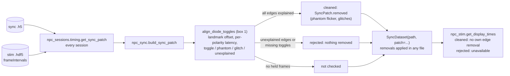
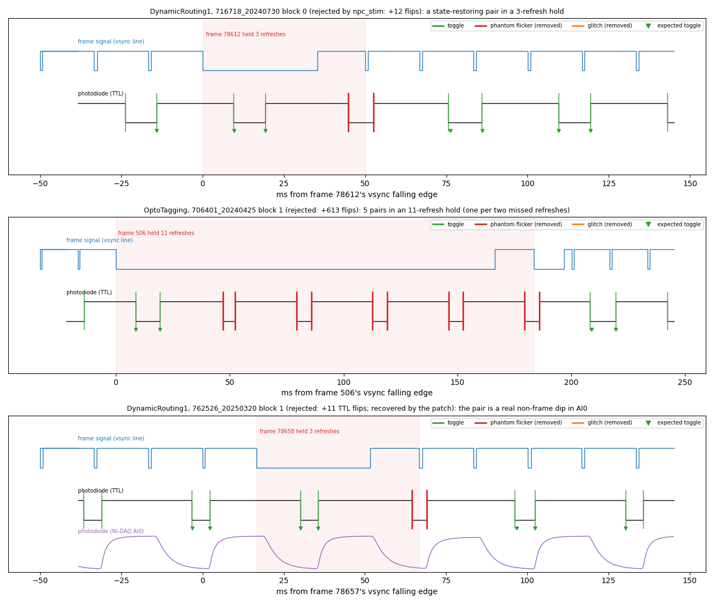
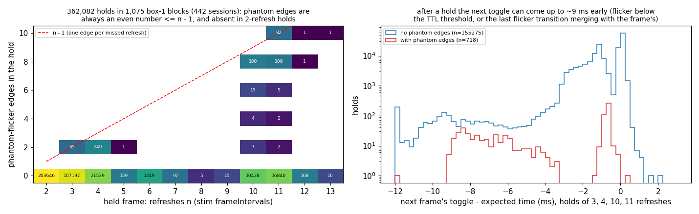
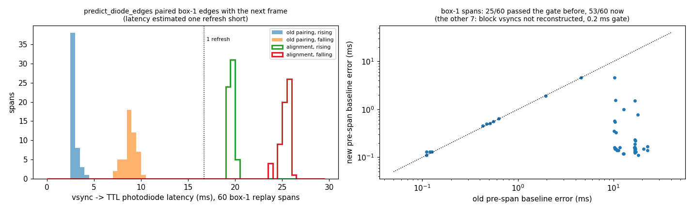

# Photodiode phantom flicker: detection, removal in the `SyncPatch`, and the box-1 replay-span fix

2026-11-17 · handoff: `notes/sync-patching-handoff-2.md` ("Critical before proceeding - phantom flicker", design agreed 2026-11-17) · previous report: `outputs/sync-patching-report.md`.
Evidence: `experiments/phantom-flicker/` (scripts, logs, CSVs, `figs/`; see its README). Population: the 442 cached Task 2 pilot sessions in `C:/data/t2p_cache` (441 run; see Caveats) and the 155 replay spans of the P0 manifest (share).
Code: branches `sync-patch` of npc_sync, npc_stim and npc_sessions, merged into local `main`. **Nothing is pushed.**

## Summary

- **Phantom flicker is real light, and it is regular.**
  - With `diodeBoxFrameInterval` 1, a held frame (a dropped frame in the stim's `frameIntervals`) can show extra TTL edges while it is held.
  - Across 362,082 held frames in 1,075 box-1 blocks they always come as state-restoring pairs, an even number, at most one edge per missed refresh (≤ n − 1).
  - They appear only in holds of ≥ 3 refreshes: none in 203,646 holds of 2 refreshes (`survey_summary.log`, Fig. 2).
  - The NI-DAQ analog diode shows each removed TTL pair as a genuine non-frame luminance dip, 10.9–11.4 ms wide (762526_20250320, 3/3; `analog_check_762526.log`).
- **This matches the old npc_sync comments.** sync.py's "phantom"/"spontaneous flicker" (on the initializing grey screen, and "extra frames at the end of the block") is the same phenomenon. The §4 "extra flips in stalls" of `outputs/display-times-issues.md` are explained: in all 24 §4 blocks every extra TTL edge is accounted for, and 23 of 24 have no unexplained edge (`section4_accounting.log`).
- **It only ever affected blocks that were already rejected.** No block that npc_stim accepts today contains a phantom edge. All 39 box-1 blocks with phantom edges were rejected by npc_stim: flip count, misalignment vote, or the rise + 15 ms check.
- **Implemented as agreed.**
  - npc_sync aligns every box-1 block's diode edges with its frames (`align_diode_toggles`).
  - The `SyncPatch` removes phantom flicker and comparator glitches from the measured line, in every file, with or without replays (`SyncPatch.removed`). It records a per-block outcome: cleaned, rejected or not checked (`SyncPatch.diode_blocks`).
  - npc_sessions builds a patch for every session.
  - npc_stim uses a cleaned block as patched and removes nothing itself, under a test. A block whose edges aren't all explained is rejected.
- **No regression.** With the patch, npc_stim's display times are byte-identical for all 1,936 blocks it accepts today, with 0 lost.
  - **11 DR1 task blocks are recovered.** They include the §5 "misalignment steps" blocks and the §1c block 733891_20240918 b4, which were phantom flicker too (`compare_population.log`).
  - **20 cleaned blocks stay rejected by npc_stim's own checks.** 14 OptoTagging and 6 DR1 (see Results).
- **The 21 box-1 "wrong polarity after the span" failures are not phantom flicker.** There are 0 phantom or glitch edges within 3 s of any of the 60 box-1 replay spans.
  - **20 are a pairing bug in `predict_diode_edges`.** Its pairing rule assumes the diode latency is shorter than one toggle period. With box interval 1 it isn't (latency 19–26 ms vs 16.7 ms), so edges were paired one frame late (latency estimated at 2.5–4.1 and 7.0–10.1 ms). The pairing then broke at every dropped frame.
  - **The 21st is a second bug:** copies from a neighbouring replayed span inside the check window.
  - **Fix:** box-1 spans now use the block alignment. 53/53 spans with reconstructed vsyncs pass (21/53 before). The other 7 are one block whose vsyncs fail their own 0.2 ms gate (`diode_gate_recheck.log`).
- **The bug also affected box-1 spans that passed the old gate.** Its 10–22 ms "baseline" made the gate permissive enough to pass predicted edges that were a refresh off at held frames. Box-1 spans are now checked against a 0.16 ms median baseline. Box 3 is unchanged (88/90 in both).
- **Not done (needs you):**
  - npc_stim's after-hold frame placement (it causes the 20 remaining rejections)
  - the handoff's decisions 1 (`invalid_times`) and 4 (ephys gate)
  - release and push

## What phantom flicker is

*Figure 1. Diode TTL edges classified by `align_diode_toggles` (green: toggles; red: phantom flicker, removed). The shaded area is the held frame (stim `frameIntervals`). Top: a DR1 3-refresh hold with one state-restoring pair; the restoring edge falls exactly on the refresh-aligned latency. Middle: an OptoTagging 11-refresh hold with 5 pairs (brief dips every second refresh). Bottom: 762526_20250320, with the NI-DAQ AI0 trace. In this part of that session both the TTL and AI0 show short black phases (slow black transitions; see Results, analog). The removed pair coincides with a non-frame dip in AI0.*

- **Mechanism (inference).** While frame k is held, the display shows the other buffer for single refreshes ("the display re-presenting the previous buffer", `outputs/display-times-analog-validation.md` §4). Box interval 1 alternates colour every frame, so a flash is a full-contrast change of the box, and the restoring refresh brings back frame k's colour before frame k+1's toggle. I haven't checked the driver or PsychoPy side.
- **Amplitude varies.** In 716718_20240730, 3-refresh holds first show nothing on the TTL, then the next toggle comes 5.4 → 9.4 ms early (frames 41,126–57,092), then TTL pairs appear (from frame 78,612). The first edge of each pair drifts from +2.5 to +9 ms late, and then the pairs disappear. This is the user's "their amplitude can change over time". Below the TTL threshold the flicker leaves no edge to remove, but it can still advance the next toggle (Fig. 2, right).
- **The rule (Fig. 2, left).** Phantom edges inside a hold of n refreshes: n = 3: 2 edges (65 holds); n = 4: 2 (249); n = 10: 2–8 (206); n = 11: 2–10 (200); n = 12–13: 8–10 (3).
  - The count is never odd, never above n − 1, and never non-zero for n = 2 (0 of 203,646).
  - So "at most one per missed refresh" and "state-restoring pair" are both empirical constraints, not just choices.

*Figure 2. Left: phantom-flicker edges per hold vs the hold length in refreshes, for all 362,082 holds. The red line is n − 1. Right: residual of the first toggle after a hold, for holds with and without TTL phantom edges. After phantom holds the toggle comes up to about 9 ms early.*

## Method (npc_sync `align_diode_toggles`)

1. **Comparator glitches.** Clusters of edges less than 0.83 ms apart (npc_stim's `DEFINITE_SHORT_INTERVAL_THRESHOLD`) are set aside: an even cluster whole, an odd one keeping its last edge, as npc_stim did. A display changes at most once per refresh, so these are not light.
2. **Frame ↔ edge offset from landmarks.**
   - With box interval 1, the latency (~20 ms rising, ~25 ms falling) is longer than a refresh. Regular frames therefore can't distinguish v[k] + L from v[k+1] + L − R. A score over the whole block picked that alias (`try_align` history in the scripts).
   - A landmark is a long diode interval whose length matches a held frame on the refresh grid, starting 5–35 ms after it.
   - At least 3 consistent landmarks are required (≥90% within 8 ms of their polarity's mode); otherwise the offset is undetermined and nothing is changed.
   - The on-grid and 5–35 ms conditions remove the alias that a late `flip()` return produces (next bullet).
3. **Toggles.**
   - Per-polarity latency is piecewise constant between held frames; it can switch by about 5.5 ms at a stall.
   - Each frame takes the polarity-correct edge within 12 ms of its expected time.
   - A second pass, bounded below by the frame-signal rising edge + 15 ms, catches **late `flip()` returns**: the frame-signal falling edge and PsychoPy's frame interval are late, but the frame was displayed on time. This is common: in 1,507 off-grid holds the next toggle needed the second pass 645 times. In those cases PsychoPy's `frameIntervals` puts the "dropped frame" one frame early. This is not flicker, and the diode is right.
4. **Classification.** Edges between the toggles of frames k and k+1 are phantom flicker only if frame k is held for n ≥ 3 refreshes and they are an even number ≤ n − 1. Anything else between the first and last toggles is unexplained.
5. **Block outcome.**
   - **Cleaned:** no unexplained edge, no toggle missing except possibly the first or last frame's (a known boundary case npc_stim handles), and no unexplained long-interval mismatch (below). Glitches and phantom edges are removed.
   - **Rejected:** any failure. Nothing is removed, and npc_stim reports the block unavailable with the patch's reason.

**The user's validation, "long-interval indices from the stim file should perfectly match those on the patched line".**
- The check compares latency-corrected toggle-to-toggle intervals of 1.5 refreshes or more with the stim's long intervals.
- The mismatches it finds have two known causes, neither phantom flicker nor misassignment:
  - late `flip()` returns, where the stim side is wrong: 1,878 mismatches in 488 blocks
  - after-hold TTL deviations above ¼ refresh: 13,291 mismatches in 165 blocks
- Mismatches with neither cause would fail the block. There are **0 in all 1,075 blocks** (`survey_summary.log`).
- A literal "perfect match" would reject hundreds of accepted DR1 blocks for late `flip()` returns, which aren't diode errors.

**Assignment check against npc_stim.** On the 1,029 accepted box-1 blocks whose offset is determined, the TTL edge my alignment assigns to each frame equals npc_stim's raw-edge assignment: 33,985,956 of 33,985,956 frames (`crosscheck_npc_stim.log`). npc_stim's assignment is the one the analog validation checked for 2025+ blocks (0 misassigned toggles).

## Results

### Population: display times with and without the patch (`compare_population.log`)

441 sessions, 2,369 blocks, npc_stim on the branch.
- **Sanity check (A = no patch).** The branch reproduces the released behaviour: 1,936/1,936 photodiode arrays are identical to `fixE`, and 70/70 unavailable blocks match.

| A (no patch) → B (patch) | Blocks |
|---|---:|
| photodiode → photodiode, byte-identical | 1,936 (0 changed) |
| photodiode → unavailable | **0** |
| unavailable → photodiode (recovered) | **11** (all DynamicRouting1) |
| unavailable → unavailable | 59 |
| files with replays (A raises unpatched) | 354 photodiode, 9 unavailable (61 sessions) |

- **The 11 recovered blocks**, by npc_stim's reason for rejecting them before:
  - **Flip count over ±5:**
    - 716718_20240730 b0
    - 733891_20240916 b4
    - 741148_20241016 b3
    - 762526_20250320 b1
  - **"Too many frames are misaligned"** (§5 steps of +2 to +4 frames; these were phantom pairs):
    - 674562_20231002 b3
    - 674562_20231003 b4
    - 703881_20240509 b1
    - 708016_20240502 b4
    - 733891_20240919 b4
    - 761583_20241219 b3
  - **"3,829 frames … flip < 15 ms after rising edge"** (§1c):
    - 733891_20240918 b4
- **Totals.** 3,916 phantom-flicker edges were removed in 33 blocks of 27 sessions, and 788 glitch edges in 56 blocks. Per-block records cover 1,162 cleaned and 11 rejected blocks. Another 1,175 are not checked: 1,045 with box interval > 1, 127 without enough held frames to fix the offset, and 3 with vsync problems.
- **The 11 rejected blocks** were all already unavailable: 9 blocks where the diode signal is lost for long stretches (as in `display-times-issues.md` §4; up to 104,905 toggles missing), plus 702136_20240306 b3 and 708016_20240501 b4 (2 and 4 unexplained edges).
- **20 blocks are cleaned but still rejected by npc_stim** (14 OptoTagging, 6 DR1):
  - **19 by its "display < frame-signal rise + 15 ms" hard check.** The frames involved are the first after a hold, whose TTL toggle comes early. npc_stim places that frame at an integer number of refreshes after the previous "on" flip, using `asym_round(·, 0.9)`. That rounds 3.36 refreshes down to 3, so the frame lands one refresh early and before its frame signal rose. Example: 706401_20240425 b1, 18 frames (frame 697: estimate − rise = 10.5 ms, raw edge − rise = 17.9 ms).
  - **1 by its misalignment vote** (702136_20240305 b3).
  - **Why they stay rejected:** these rejections are correct as long as the estimator places those frames that way.

### §4 blocks (`section4_accounting.log`)

| | |
|---|---|
| §4 blocks (`display-times-issues/flip_extra.csv`) | 24 |
| every extra TTL edge accounted for (phantom + glitch + outside + unexplained − missing) | 24/24 |
| blocks with no unexplained edge | 23/24 (708016_20240501 b4: 4) |
| phantom-flicker edges, all inside stim-recorded holds of ≥3 refreshes | 3,894 |
| recovered (photodiode with the patch) | 4 (716718_0730 b0, 733891_0916 b4, 741148_1016 b3, 762526_0320 b1) |
| still rejected by npc_stim | 19 (18 by the rise + 15 ms check, 1 by the misalignment vote), plus 708016_20240501 b4, which the patch itself rejects |

### Replay spans: the box-1 photodiode prediction (`diag_polarity.log`, `diode_gate_recheck.log`)

*Figure 3. Left: the old pairing rule estimated box-1 latencies one refresh short (2.5–4.1 / 7.0–10.1 ms). The block alignment gives 19.4–20.1 / 23.5–26.0 ms. Right: the pre-span "baseline" error the old gate compared against was 10–22 ms wherever a hold was in the window, which made the gate permissive.*

| Spans of the P0 manifest | Box 1: old | Box 1: new | Box 3: old | Box 3: new |
|---|---:|---:|---:|---:|
| block vsyncs reconstructed (0.2 ms gate) | 53 | 53 | 90 | 90 |
| of those, photodiode gate passed | 21 | **53** | 88 | 88 |
| pre-span baseline error, median / max (ms) | 11.4 / 22.5 | 0.16 / 6.45 | — | unchanged except 1 span |

- **The 21 "wrong polarity after the span" failures (20 + 1):**
  - **20 spans.** Every edge flagged as wrong polarity (24 edges) is the real toggle of a held frame (n = 2 or 3) after the span. That is the pairing bug: between dropped frames the one-frame offset is consistent, and at a held frame it breaks.
  - **1 span, DRpilot_796012_20250625 at 3310 s.** It saw copies from the neighbouring replayed span, 3 s away. `predict_diode_edges(..., exclude=)` now ignores them. That change moves one box-3 baseline, 872697_20260828 b2, from 0.85 to 0.19 ms.
  - **No flicker.** There are 0 phantom, glitch or unexplained edges within 3 s of any of the 60 box-1 spans, so phantom flicker is not the explanation.
- **New prediction (`predict_box1_diode_edges`).** Inside a span, each unobserved frame gets its expected toggle (frame time + local per-polarity latency). Held frames get no toggle until the next frame's.
  - The check after the span uses the block alignment: no unexplained or missing toggles within 3 s. The toggles in the 0.5 s after the span must be within the pre-span error + 0.5 ms.
  - Toggles right after a hold, and late `flip()` returns, are left out of both the baseline and the check, because their TTL timing deviates in ways the prediction can't model.
- **Side effect: a handoff failure fixed.** The 2 `test_opto` failures for 636766_2023-01-23 were caused by its RF-mapping block's span (589.0–589.5 s), one of the 21 polarity failures. That span is now reconstructed, and the npc_sessions suite passes: 23/23 (`experiments/phantom-flicker/npc_sessions_tests.log`; before: 20 passed, 2 failed).
- **The 7 box-1 spans that still fail** are all in 644867_20230221 block 0, whose vsyncs fail the 0.2 ms per-gap gate. The same 2 box-3 spans as before fail (831994_1210, 872974_1109).
- **Spans that passed the old gate were also affected.** In 25/60 box-1 spans the old gate passed, often against a 10–17 ms baseline, so predicted edges at held frames inside them could be a refresh off (shown in `tests/test_phantom_flicker.py::test_box1_prediction_in_a_replayed_span`). Only 1 box-1 span had an analog check before, 796012_20250710, and it passed with a 0.19 ms in-window error; I didn't check whether it contains a held frame.

### Analog check: DRpilot_762526_20250320 b1 (`analog_check_762526.log`)

This is the only recovered block from the analog era (AI0 photodiode from 2025-01-13). The ground truth is the DP alignment of `display-times-analog-validation`, which uses no TTL diode edges.

| Check | Result |
|---|---|
| each removed phantom TTL pair lies inside a non-frame analog dip | 3/3 (TTL pair 2.0–4.5 ms wide; analog dip 10.9–11.4 ms) |
| removed glitches at a frame's analog transition | 4/4 (−0.84 to −1.08 ms) |
| other non-frame analog transitions | 2 dips at stalls with no TTL edges (below threshold: nothing to remove); 1 at the block end (the TTL edge there is "outside" and left alone) |
| frame ↔ TTL edge vs the analog DP | 216,841/216,849 agree; 8 differ (frames just before a 3-refresh hold in frames 63k–78k, TTL − analog ≈ +9.6 ms; not investigated) |
| display times vs analog, block 0 (control) | p1/p99 −0.36/+0.44 ms, max 0.53 ms: identical to `compare.py` |
| display times vs analog, block 1 (recovered) | p1/p99 −1.37/+2.38 ms, max 14.9 ms; 2.1% of frames > 2 ms, 60 > 8 ms |

**The block-1 tail is a property of that stretch of the session, not of the patch.**
- 96% of the frames over 2 ms fall in frames 65,055–86,739, and 98% of them are falling (black) frames.
- For box 1, npc_stim places those frames at midpoints between rising flips.
- In that stretch the white→black fall is slower: the TTL falling edge is about 5 ms late, and it comes before the analog 0.25-crossing instead of 2.8 ms after it.
- Elsewhere in the block p99 is ≤ 1.9 ms. It is the analog report's open question of which crossing counts as the display time.
- The patch removed 10 edges, at 3 holds and 2 glitches.

**Removed edges' analog amplitude** (the user's "sometimes less than full amplitude"). The TTL pulses of the three phantom pairs (2.0–4.5 ms) are much narrower than their analog dips (about 11 ms). The TTL crosses the threshold late on the fall and early on the rise, which fits a dip that doesn't reach full black. I didn't measure dip depth from the trace directly.

## No double-fixing: the earlier mechanisms

| Mechanism (where) | Addressed | Now |
|---|---|---|
| npc_stim `anomalous_interval_indices` removal of short flip pairs | glitches; would also remove short phantom pulses | **skipped for cleaned blocks**; the patch removed them. Test: `test_patch_cleaned_line_is_consumed_without_further_removal` (it fails with the guard disabled). Output identical on 1,936 blocks |
| npc_stim ±5 flip-count tolerance | extra or missing flips | unchanged; for cleaned blocks the count is exact apart from "outside" edges after the last toggle |
| npc_stim end-of-block truncation of fewer than 5 extra display times ("spontaneous flicker") | edges after the last frame (screen to grey) | unchanged; the patch doesn't touch "outside" edges, and no extra edge is left inside a cleaned block |
| npc_stim whole-block +1 offset (`correct_whole_block_frame_offset`) and the ±1 vote | first toggle missing (initializing-screen flicker) | unchanged; missing toggles at a block's first or last frame are allowed by the patch and left to npc_stim; nothing is removed for them |
| npc_stim rise + 15 ms hard check | flips misassigned | unchanged; it now catches the after-hold placement issue (19 blocks) |
| npc_sync `predict_diode_edges` "allow one" pre-span mismatch, 3 s polarity window | the box-1 pairing breaking at holds | box 1 no longer uses it; box 3 unchanged apart from excluding copies |
| `discard_erroneous_diode_flips_at_stim_offset`, `add_missing_diode_flip_at_stim_onset` | grey-screen flicker at block ends | dead code in npc_stim (not called); untouched |
| analog report's "keep the first flip in a long vsync interval" rule | §4 | never implemented; superseded |

## Disagreements, caveats

- **Strictness vs the agreed design.**
  - **What follows the design.** Every removal is a state-restoring set inside a stim-recorded hold of ≤ n − 1 edges. Any other extra edge rejects the block.
  - **Glitch removal, added by me.** Sub-ms chatter was moved into the patch because npc_stim must not remove edges any more and these aren't flicker. They are counted separately, and the outcome is identical to npc_stim's old removal. Reversible.
  - **Validation criterion relaxed, by me.** Mismatches explained by late `flip()` returns or after-hold timing are allowed; see Method. Reversible.
- **Box 3.** Phantom-flicker handling is limited to box interval 1, as specified. I didn't survey box-3 blocks for extra edges in holds; their records say "not checked".
- **Undetermined offset.** 127 box-1 blocks have fewer than 3 landmarks (mostly Spontaneous*, 0–2 holds). They are not checked, and npc_stim keeps its own handling.
- **Not run: DRpilot_366122_20250109** (dev mouse, box interval 2). npc_stim's O(n²) flip removal (restored in `cfae3e3`) takes more than 2 h, with or without a patch.
- **Analog coverage.** Only one recovered block is in the analog era. The other recovered blocks (2023–2024) are checked through consistency with npc_stim's analog-validated assignment and the alignment's own residuals.
- **Mechanism.** That the display shows the other buffer during a hold is still an inference.

## Answers to the handoff's validation items

| Item | Answer |
|---|---|
| long-interval indices on the patched line match the stim | 0 unexplained mismatches in 1,075 blocks. The 15,169 explained ones are late `flip()` returns (stim side) or after-hold TTL deviations |
| removed edges have less than full-amplitude AI0 transitions | 3/3 removed pairs are narrow TTL pulses (2–4.5 ms) inside about 11 ms analog dips; depth not measured |
| rerun the box-1 gate | 53/53 box-1 spans with reconstructed vsyncs pass (was 21/53); the 21 polarity failures were a pairing bug plus copies, not flicker |
| do the §4 stall extra flips fall inside recorded long intervals | yes: in 24/24 §4 blocks every extra edge is accounted for, and all 3,894 phantom edges are inside stim-recorded holds of ≥ 3 refreshes; the remainder are glitches, block-end edges, and 4 unexplained edges in one block |
| no double-fixing | see the table above; output byte-identical on 1,936 accepted blocks |

## Next steps

1. **npc_stim after-hold placement (likely recovers 19 of the 20 cleaned-but-rejected blocks).** For box interval 1, place the first frame after a hold from the stim's recorded hold length, instead of `asym_round(·, 0.9)` of the diode interval. Re-validate against the 1,936 accepted blocks first, because it changes the estimator.
2. **Decisions from the handoff, not implemented here:**
   - 1: replayed intervals out of `invalid_times`, keep the trials, NaN response times
   - 4: one ephys gate, < 1 ms for AP
3. **Release.**
   - The merges are local. A push to `main` publishes npc_sync and npc_stim.
   - npc_sessions needs floors on the released versions: the CI bumps the patch number, so set the floors after release.
   - The strict default in npc_sync is breaking for rig QC and npc_sessions_cache on files with replays.
4. **Optional.** Survey box-3 blocks for extra edges in holds, and box 2 (366122) once npc_stim's removal is fast again.

## Changes (branches `sync-patch` → local `main`)

- **npc_sync**
  - `patch.py`:
    - added: `align_diode_toggles`, `DiodeToggleAlignment`, `diode_glitch_mask`, `predict_box1_diode_edges`, `DIODE_*` constants with their evidence
    - `SyncPatch` (format 2, version 1 still loads): `removed` / `RemovedEdges`, `diode_blocks` / `DiodeBlockPatch`, `keep_recorded`, `diode_block`, `diode_summary`
    - `build_sync_patch`: diode cleaning for every box-1 block in any file; box-1 span prediction; splice-edge extension of diode spans; robust to sync-level failures
    - `predict_diode_edges(exclude=)`
  - `sync.py`: patch removals applied in every file
  - `tests/test_phantom_flicker.py`: 11 tests
- **npc_stim**
  - `display_times.py`:
    - consumes cleaned blocks without its own removal; rejects blocks the patch rejected
    - the rising/falling balance assert allows 1 per unknown span (it crashed DRpilot_644867_20230221)
  - `tests/test_patched_display_times.py`: 4 new tests
- **npc_sessions**
  - `timing.py`: a patch for every session, `BUILDER = "npc_sessions.timing 2"`, block report columns `diode_status`, `n_phantom_flicker_removed`, `n_glitch_removed`, tolerant of sync-level failures
  - `sessions.py`: docstring
  - `tests/test_timing.py`: 1 new test
  - **test results:** npc_sync 71 passed, 1 skipped; npc_stim 28 passed, 1 xfailed (known), 1 deselected (S3 slow test); npc_sessions 23 passed (`test_aind_metadata` not collected: optional dependencies not installed)
  - `experiments/phantom-flicker/`, this report
  - `.gitignore`: experiment logs are now tracked; they were ignored by `*.log`, so the evidence logs of earlier reports were on disk only

## Sources

- Handoff and design: `notes/sync-patching-handoff-2.md`. Earlier work: `outputs/sync-patching-report.md`, `outputs/display-times-issues.md` (§1c, §4, §5), `outputs/display-times-analog-validation.md` (§4, Fig. 5).
- Old npc_sync phantom-flicker notes: npc_sync `55dfefe:src/npc_sync/sync.py` (`frame_display_time_blocks`, `get_frame_display_times`), `tests/test_known_files.py::test_screen_flicker_file`.
- TaskControl `showFrame` (box toggles every `diodeBoxFrameInterval` frames): `DynamicRoutingTask/TaskControl.py` L394–418.
- Evidence: `experiments/phantom-flicker/` (`survey_summary.log`, `crosscheck_npc_stim.log`, `compare_population.log`, `diag_polarity.log`, `diode_gate_recheck.log`, `section4_accounting.log`, `analog_check_762526.log`, `figs/`); acceptance re-runs `experiments/sync-patch-manifest/acceptance_local7.log` (A1–A8 all pass, unchanged) and `p2_display_times_local.log` (B1–B5 all pass, unchanged).
