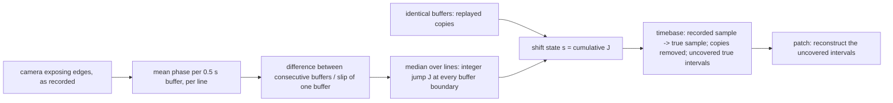

# Dropped sync buffers: locating them and patching the data

Date: 2026-11-19/20. Task: `notes/sync-dropped-chunks-task.md`. Evidence: `experiments/sync-timebase-drops/` (see its README). Plan and ledger: `outputs/.plans/sync-dropped-chunks-plan.md`.

## Status

| Item | State |
|---|---|
| npc_sync | 0.3.8 on PyPI. CI: 72 passed, 16 skipped on ubuntu, macOS and windows (run 44695310796). |
| npc_sessions | 0.0.294 on PyPI, floor `npc-sync>=0.3.8`. CI: mypy clean, 65 passed, 2 skipped (run 44695811631). **Superseded by 0.0.296** (builder 8, barcode spans; see "Follow-up: barcode line"). |
| Patch cache | 5 sessions written to `s3://aind-scratch-data/dynamic-routing/cache/sync_patches/` with the released npc_sync, then reloaded from it in a new process (`e2e_release.json`, `e2e_release_reload.json`). |
| Not done | See "Not fixed, and limits". npc_sessions_cache was not touched. |

## Summary

- **Drops and replays are the same fault.** The sync program drops 0.5 s acquisition buffers without leaving a gap in sample numbers. Later it writes copies of a buffer, one per dropped buffer, which brings the sample count back in step. A "replay" is that run of copies.
- **Data between a drop and its run of copies is recorded early.** The gap is 0 s for a third of drops and up to 20.5 s for the rest (median 2.0 s). In that stretch every line is early by 0.5 s per buffer dropped so far (up to 6.5 s in the sessions checked with licks). This is what the complementary long/short barcode pairs are: a barcode recorded inside such a stretch. The two outer barcodes are on time, as you said, but everything recorded in the stretch is mis-timed on the recorded clock, and the replay patches released so far did not move it. 16 of 152 replay files have such stretches. The three that are npc_lims sessions were refused anyway, because a barcode fell in a stretch; 9 share-only files had no barcode in one and would have passed unnoticed (npc_lims membership as in the P0 manifest of 2026-11-17).
- **The cameras locate every drop exactly.** A buffer is 30 camera periods minus 12–26 µs. The mean camera phase of each buffer therefore steps by a whole multiple of that amount at a drop and by exactly one unit back at each copy. Over 256 files the step at every observed buffer boundary is within 0.16 of an integer.
- **One correction covers both.** npc_sync now builds a timebase for the file: displaced data is moved to its true time, copies are removed, and what remains are the intervals that no recorded buffer holds. Those intervals are reconstructed with the existing replay machinery.
- **Four of the five affected npc_lims sessions are now fully usable.** 840160_2026-04-28 and 715709_2024-08-08 (pure drops) and 703880_2024-04-18 and 708020_2024-05-17 (replays with barcode pairs) were all refused before. 714748_2024-06-28 gets 7 of 8 blocks; its task block is still rejected, by the photodiode check. Details in "End to end".

## How the drop is located

Model: recorded buffer p holds the data of true buffer p + s(p). The shift state s rises by k where k buffers were dropped and falls by 1 at each copy.

- **Input:** rising and falling edges of every `*_cam_exposing` line, as recorded. Barcodes, vsyncs and stim files are not used, so they stay available as independent checks.
- **Measurement:** for each line, the residual of each edge against a strict period, averaged per buffer. The difference between consecutive buffers, divided by the line's slip per buffer (30 × period − 0.5 s), is the jump in buffers.
- **Acceptance of a boundary:** the median over lines is within 0.25 of an integer, and lines from at least two cameras agree with it. One camera is not enough.
- **Copies:** found as before, from identical buffers. Each copy must measure −1; all 1,475 do.
- **Fallback:** if the drops that a run of copies makes up for are not seen (cameras not running), they are assumed to be at the start of the run. That is the model used until now. It happened once in the survey (a 30,000-sample "replay" 1.5 s into a file, before the cameras start).
- **Remaining discontinuities:** a drop the cameras can't locate still shows as a barcode discontinuity on the timebase, and npc_stim still refuses the file.

## Evidence

### Survey of the timebase (256 files; `survey_summary.log`)

| | Clean files (100) | Files with replays or barcode discontinuities (156) |
|---|---:|---:|
| Buffer boundaries observed | 818,155 | – |
| Jumps found outside copies | 0 | 1,169 drops (1,487 buffers) |
| Largest \|jump − integer\| | 0.118 | 0.154 |
| Replayed copies | 0 | 1,475, all measuring −1 |
| Drops assumed at the run start (not seen) | 0 | 1 |
| Barcode discontinuities, recorded clock | 0 | 37 intervals in 11 files |
| Barcode discontinuities, on the timebase | 0 | 0 |

- The count closes: 1,487 located buffers = 1,475 copies + 13 buffers of net shift in the four pure-drop files − 1 assumed.
- Pure drops are single jumps of +4, +1, +3, +3 and +2 buffers (715709_20240808 twice, 717473_20240916, 832032_20260223, 840160_20260428), each equal to the barcode shift.
- 16 of 152 replay files have data displaced before a run. In the other 136, every drop is at the start of its run, so the earlier model was right for them.
- Recorded time between a drop and its run, summed over all files: 2,361 s.

### Independent checks

| Check | Clock it rests on | Result |
|---|---|---|
| Barcode onset intervals (`survey_summary.log`) | barcode generator | 37 irregular intervals in 11 files → 0 |
| Licks in displaced data vs the stim file's `lickFrames` (`lick_validation.log`) | stim PC | 3,901 licks in 11 sessions: 6% within 25 ms of a stim lick at the recorded time, 99% at the true time (on-time licks: 99.8%) |
| Vsync frame solve per gap (`vsync_gap_summary.log`) | display refresh + stim PC | 160 blocks with a fault: residual median 0.385 → 0.024 ms; gaps over 0.2 ms 453 of 778 → 12 of 1,144; blocks with a frame-count imbalance 22 → 1 |
| Ephys barcode fit, end to end (below) | Open Ephys | devices pass with leave-one-out residuals ≤ 0.4 ms |

- The vsync result explains the residual left open in the replay work ("about −0.55 ms per second of span" in multi-run files). A buffer is 30 display refreshes minus 0.42 ms, so an anchor recorded in a displaced stretch is off by that amount per buffer.
- No block that reconciled on the recorded clock fails on the timebase.

### End to end (5 ephys sessions; `e2e_release.json`, `e2e_release_summary.md`)

These are the five npc_lims sessions among the 20 files with displaced data or a net shift. Run with the released packages and the S3 patch cache.

| Session | Fault found | Before (npc_sync 0.3.7) | Now |
|---|---|---|---|
| 840160_2026-04-28 | 2 buffers dropped at 2472.0 s | Refused: `AssertionError`, timebase discontinuity of −1.0 s (`e2e_old.jsonl`) | 4/4 stims have frame times. Task block patched: 64 frames reconstructed, vsync residual 0.17 ms. 509 trials. Ephys 12/12 pass, residual ≤ 0.32 ms |
| 715709_2024-08-08 | 4 buffers dropped at 258.5 s, 1 at 2078.0 s | Task block rejected (217,171 vsyncs, 217,320 stim frames). Ephys 6/6 fail on a 1.97 s step (`e2e_old.jsonl`) | Task block patched: 162 frames reconstructed, residual 0.04 ms. 536 trials. Ephys 6/6 pass, residual ≤ 0.25 ms |
| 703880_2024-04-18 | 58 single buffers dropped, 58 copies | Refused: 4 barcode discontinuities (`old_refusal_check.log`) | 8/8 stims have frame times, 4 blocks patched, residual ≤ 0.17 ms. 538 trials. Ephys 13/13 pass, residual ≤ 0.36 ms |
| 708020_2024-05-17 | 140 single buffers dropped, 140 copies | Refused: 2 barcode discontinuities | 4/4 stims have frame times. Task block patched: 130 spans, 4,669 of 216,710 frames reconstructed, residual ≤ 0.15 ms. 528 trials. Ephys 3/3 pass, residual ≤ 0.40 ms |
| 714748_2024-06-28 | 268 buffers dropped at 263 places, 268 copies | Refused: 6 barcode discontinuities | 7/8 stims have frame times. **Task block still rejected**, by the photodiode check (below). No trials table. Ephys 13/13 pass, residual ≤ 0.36 ms |

- "Residual" for ephys is the largest leave-one-out barcode residual over the session's devices (npc_ephys timing QC).
- "Before" for the last three rests on the released code path (npc_stim refuses any file with a barcode discontinuity) and the discontinuities measured with npc_sync 0.3.7. I did not run the old pipeline to completion on them: it stalled on 703880 for 50 minutes and I stopped it.
- No barcode discontinuity is left in any of the five on the timebase.
- **714748 task block:** the vsync frames reconcile (230 spans, residual ≤ 0.30 ms), but the box-1 photodiode alignment leaves 4,072 diode edges unexplained. The first is at 4129.37 s, where a frame-signal edge is 22 ms late, with no dropped interval nearby. This is the existing alignment check being strict on a session with very irregular frame timing. It is not caused by the timebase, but I did not fix it.

## Follow-up (2026-11-20): barcode line after the patch

You saw double-length barcode intervals and a small long/short pair on the patched line of 703880. Both were real, and both came from the barcode-span step in npc_sessions, not from the timebase (`barcode_intervals.md`, all barcodes, none excluded):

| 703880_2024-04-18 | Barcodes | Intervals off the period by > 1 ms |
|---|---:|---:|
| Recorded clock | 249 | 8 |
| Corrected clock, spans not applied | 249 | 0 |
| Patched, builder 5 (what you saw) | 244 | 2 (+765 / −765 ms), plus 5 double intervals |
| Patched, builder 8 | 242 | 0, plus 7 double intervals |

- **The pair** was a barcode cut to 2 of its 11 pulses. Builder 5 padded each dropped interval by 2 s and stopped where the line was low, which can be between two pulses of one barcode. My discontinuity check skips barcodes near invalid intervals, so it didn't see it.
- **Builder 8** removes whole barcodes only: every barcode the padded span touches, any that may continue into a dropped interval, and the tail of one whose onset fell inside it (three such tails in 708020 and 714748).
- **The double intervals remain, and are exact** (within 0.15 ms of 2 × the period). They are barcodes within 2 s of a dropped interval, removed although most are complete. The padding has to stay: npc_ephys drops barcode edges within 2 s of every invalid interval, one by one, and fails if that leaves a barcode half-cut.
- **I got this wrong twice before getting it right.** Builders 6 and 7 dropped the padding, which kept the good barcodes but made npc_ephys fail on three of the five sessions ("on and off times should be same length"). The end-to-end rerun caught it; I cancelled the builder-7 CI run before it published. Neither was released.
- **Result on all five sessions** (`e2e_release3_vs_release.md`): no off-period interval on the patched line, ephys devices all pass with the same residuals, block statuses and trial counts unchanged. Patches on S3 are builder 8 with npc_sync 0.3.9.
- **One off-period interval is left in 715709**, the first barcode of the file (0.049 s): the recording starts mid-barcode. It has nothing to do with drops and I left it.
- **To get the removed barcodes back**, npc_ephys would have to stop its own 2 s cut when the sync line is patched. I did not change npc_ephys.

## What changed in the code

| Repo | Change |
|---|---|
| npc_sync | New `npc_sync.timebase` (`find_chunk_jumps`, `build_timebase`, `Timebase`). `SyncDataset(..., timebase=)` and `find_timebase()`: with a timebase, every event query is on the true clock and `invalid_intervals` are the uncovered intervals. `SyncPatch` carries the timebase (format 3; formats 1 and 2 still load). `build_sync_patch` builds on the timebase. |
| npc_sync, smaller | Camera interpolation counts periods across neighbouring gaps. A late frame-signal edge at a gap anchor joins the gap. The box-1 photodiode check after a span ignores frames with an off-grid vsync interval. The 1 ms vsync gate applies wherever every drop is located. Block splitting no longer bridges a real gap that merely contains a dropped interval. |
| npc_sessions | Patches are built on the timebase (`timing.true_clock_view`, builder 5). `sync_data` is on the true clock. Epoch notes say "dropped acquisition buffers"; the epoch tag is still `replayed_sync`. Floor `npc-sync>=0.3.8`. |
| npc_stim, npc_ephys, npc_mvr, npc_samstim | No change needed: they take the patched `SyncDataset` from npc_sessions. |

On your point about order (replay patches first, then drop patches): the two turned out not to be separable. The copies are how the file makes up for the drops, so the timebase handles both in one step, and the reconstruction then runs once on the corrected clock.

## Not fixed, and limits

- **A block whose first frames fall in a dropped interval is still rejected.** 703880_20240412 task block: the first vsync is not stim frame 0, so the frame count is off by 16. Reconstructing backwards from the first measured vsync would need its own check.
- **714748_2024-06-28 task block** is rejected by the photodiode check (see "End to end").
- **The vsync gate is now 1 ms wherever every drop is located** (it was 0.2 ms for multi-run files). 12 of 1,144 gaps are between 0.2 and 0.43 ms; none is above 1 ms. The frame count in each gap is still protected by the 10 ms second-best margin and the exact block balance.
- **The 15 other files with displaced data are not npc_lims sessions**, so they were surveyed from the share but not run end to end. Two of them have a pure drop (717473_20240916, 832032_20260223).
- **No analog check inside the dropped intervals.** The replay work compared reconstructed photodiode edges with the NI-DAQ recording; I did not repeat that for the dropped intervals. The sound line's NI-DAQ gate (≤ 1 ms on every trial, before and after the drop) did pass in the ephys sessions.
- **Files with one camera or none** can't have drops located. Runs of copies fall back to the old model; pure drops stay refused through the barcode check.
- **Behaviour-only files have no barcodes**, so a wrongly located drop would not be caught by them. None was found in 100 clean files, and a drop inside a stim block still has to pass the vsync frame solve.
- **The cause in the sync program is still unknown.** The pattern (single buffers lost, made up for seconds later by copies) should help whoever looks at the acquisition code.
- **Vsync rising edges don't alternate at a reconstructed span** (fixed since, in npc_sync 0.3.9, not by me). They are placed at falling edge − pulse width, which on real files (pulse ~15.9 ms) puts the first one next to the measured rising edge before the span and leaves none before the first measured frame after it: one rising–rising and one falling–falling pair per span, counts equal (`vsync_rising_check.md`: 840160, 715709). This predates this work. npc_stim only uses rising edges as a lower bound on display times, so the effect is a looser bound for one frame per span. Not fixed.

## Sources

- npc_sync 0.3.8 (https://github.com/AllenInstitute/npc_sync, commits 3f93573..f6ad135): `src/npc_sync/timebase.py`, `sync.py`, `patch.py`, `tests/test_timebase.py`.
- npc_sessions 0.0.294 (https://github.com/AllenInstitute/npc_sessions, commit 633ca58): `src/npc_sessions/timing.py`, `sessions.py`, `tests/test_timing.py`.
- Evidence: `experiments/sync-timebase-drops/` (`survey_summary.log`, `lick_validation.log`, `vsync_gap_summary.log`, `shift_state_703880_0418.log`, `e2e_release.json`, `e2e_release_reload.json`, `e2e_old.jsonl`, `old_refusal_check.log`).
- Earlier reports: `outputs/sync-patching-report.md`, `../npc_sync/outputs/sync-dropped-data.md`.
