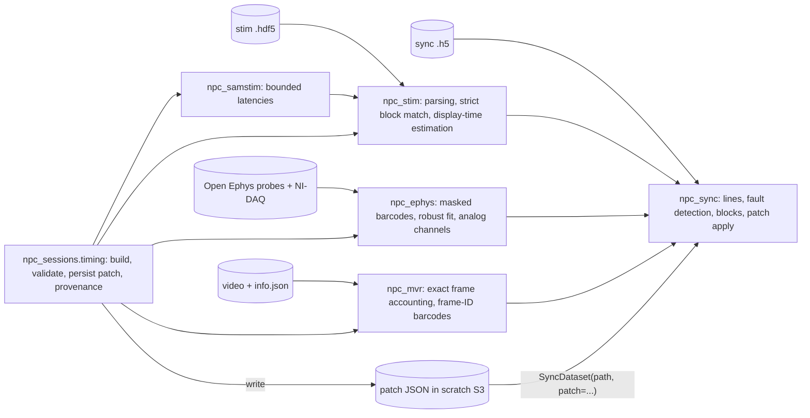

# Sync frame-timing upgrade: implementation plan

2026-11-12 · input: `notes/sync-frame-timing-upgrade.md` · status: plan only, no library code changed.
Code refs: npc_sync `8974ba0` (0.2.8), npc_stim `1daf580`, npc_mvr `f98700b`, npc_samstim `4f802fa`,
npc_ephys `e8bc660`, npc_sessions `65ca4bd`. Evidence: `experiments/sync-frame-timing/` (scripts + logs, see its README).

## Decisions

1. **npc_sync becomes a line layer; frame display-time estimation moves to npc_stim.** npc_sync keeps event access, fault detection, block splitting and the line map. Everything that interprets the stimulus (the diode box, monitor latency, stim-file lookup) moves to `npc_stim.get_display_times` (see [Moves](#moves-from-npc_sync-to-npc_stim)). That breaks the current dependency cycle, in which npc_sync needs `npc-stim>=0.1.23` and npc_stim needs `npc-sync>=0.2.2`. npc_samstim stays a separate package.
2. **Strict by default.** If a file has invalid intervals and no patch is supplied, any edge query raises, on every line. The copies hide real events. For example, 6 real licks happened inside the 839146 window, but the copies contain no lick edges.
3. **`invalid_intervals` is necessary but not sufficient.** In files with many runs, some barcode onsets *outside* the intervals are displaced by exactly k × 0.5 s. Add a displaced/dropped-buffer check (barcode onset intervals, per-gap residual, block balance). Reject what fails it.
4. **Repair with a patch, not rewritten files.** `npc_sync.SyncPatch` holds per-line replacement edges inside invalid intervals, each with a source and an error bound. npc_sessions builds it, writes it to scratch S3 (path from npc_lims) and applies it with `SyncDataset(path, patch=…)`. The patch is keyed to a hash of the sync file and to the builder version.
5. **npc_sessions owns correctness.** It builds, validates and persists the patch, and passes one patched `SyncDataset` everywhere. It also adds `timing_source` columns and puts anything it can't reconstruct in `invalid_times`.
6. **Only patch a line when the count is exact and the error is ≤1 ms beyond the measured-data baseline.** Licks don't meet this: they are reconstructed in the tables, flagged, and never written to the line.
7. **Reject first, then explain.** Remove all count tolerances. A block must match exactly, after explicit, evidence-backed corrections; anything else goes to a triage manifest.

How the options in the note compare:

| Option | For | Against |
|---|---|---|
| A. All timing in npc_sessions; satellite libs take arrays | one owner | breaks the npc_stim, npc_samstim and npc_mvr APIs used by rig QC (np_services) and npc_sessions_cache; duplicates orchestration |
| B. "Fixed" sync files in scratch, with npc_lims redirecting to them | no consumer changes | reconstructed edges look measured; no way to say "unknown"; the repair still needs every source, so it lives in npc_sessions anyway; whole files to version |
| **C. Patch sidecar + strict npc_sync (chosen)** | APIs unchanged; provenance explicit; small artifact; every consumer gets the same corrections through npc_lims | satellite libs must become strict and patch-aware |

## Evidence

| Finding | Value | Source |
|---|---|---|
| Prevalence (Task 2 Pilot share, scanned 2026-11-03 with a pre-0.2.8 detector) | 148 of 2,916 sync files (5.1%); 783 windows, 771 of them during stim. Window length, including the genuine buffer: median 1.0 s, p99 5.3 s, max 10.0 s. Up to 137 runs in one file | `survey_summary.log` |
| The 0.2.7 fail-fast only covers `frame_display_time_blocks` | `vsync_times_in_blocks` returns corrupted blocks. The npc_stim vsync path returns 217,029 vsyncs for 217,028 frames (847958); the extra edge is a splice artefact, so every later frame is silently one off. Mismatched blocks get no key at all (the ±60 branch is dead code) | `line_audit.log` C3–C5; npc_sync report §3 |
| Granularity | one replay anywhere makes `frame_display_time_blocks` raise for every block. npc_sessions locks `npc-sync` 0.2.5, which has no detector; 0.2.8 is on PyPI | `line_audit.log`, `uv.lock` |
| Lines with copied edges (6 single-run sessions) | vsync, photodiode and every camera exposing/readout line: 6/6. Barcode (21+21 edges) and bit 1, sound (7+7): 856847_0602 only. Lick, reward, stim_running: none | `line_audit.log`, `all_bits_audit.log` |
| Real events lost (stim file, mapped by reconciled frames) | 13 trial/stim onsets across 5 sessions, 6 licks, 0 rewards, 0 opto | `lost_events.log` D2 |
| vsync rebuilt from `frameIntervals` (single gap) | anchor residual ≤0.05 ms in 6/6. Error against the analog photodiode inside the window stays at baseline (0.16–2.02 ms vs 0.17–2.16 ms before the window); indexing the raw vsyncs gives 18.6–35.7 ms | `lost_events.log` D1; `npc_sync/outputs/vsync-frame-count-discrepancies.md` |
| Camera exposures across intervals | integer-period interpolation: residual ≤0.032 ms; count unambiguous (\|Δ/p − n\| ≤0.002). The copies have the same count in 22/22 cases | `camera_gap_check2.log` |
| Barcodes | durations 0.68–1.82 s (n=1,548), longer than a 0.5 s buffer, so no copy holds a whole barcode. Masking recovers one barcode in 856847_0602, but its first edge left is mid-barcode (+272.5 ms), so its decoded value is almost certainly wrong (not checked against probes) | `all_bits_audit.log`, `lost_events.log` D3, `barcode_interval_jitter.log` |
| Barcode onset regularity | within 0.31 ms of the per-file median outside intervals (6 files). 840160: −1000 ms at 2458.56 s, a drop that `invalid_intervals` does not flag | `barcode_interval_jitter.log`; `npc_sync/outputs/sync-dropped-data.md` |
| Files with many runs (4 checked, 27–137 intervals) | 12 barcode onsets outside the intervals are displaced early by exactly k × 0.5 s (k = 1–13), 0.04–6.6 s from the nearest interval. Task blocks: 3/4 don't balance (−20, +2, −8 frames) and have gaps >3 ms. Median per-gap residual is 0.39–0.79 ms, against 0.012–0.036 ms in files with 1–5 intervals | `multi_gap_check.log`, `displaced_barcode_check.log` |
| Event latency outside intervals | reward: 0.80 ms after vsync[f] (0.69–1.35, n=689). Sound (bit 1): 7.86 ms (7.01–8.36, n=1,543). Lick: ~98% of `lickFrames` have a sync onset in the frame interval before the read (median 8.35 ms before it); task-block counts 10,540 (sync) vs 10,536 (`lickFrames`) | `event_latency_check.log`, `lick_count_check.log` |
| Root cause | the sync writer queues a reference to a reused DAQ buffer (`DIU32.py` L21, L44–46). Queueing a copy fixes it in a mock | `npc_sync/papers/sync-chunk-replay.typ` |

## Target architecture

| Package | Change | Effect on standalone users (np_services rig QC, npc_sessions_cache, np_codeocean) |
|---|---|---|
| npc_sync 0.3.0 | strict policy (`on_invalid="raise"\|"mask"`); `SyncPatch` (apply, save/load, `edge_source(line)`); pure functions `reconcile_vsyncs`, `interpolate_periodic_edges`; generic `get_edges_in_blocks(line, end_padding)`; barcode-onset integrity check, already done as `timebase_discontinuities` in `1e3261d` (every onset interval must be m × median ± 10 ms, where m > 1 means a missing barcode; anything else is a displacement or drop); block splitting treats invalid intervals as unknown rather than as gaps (masked gaps >1 s would split blocks at `min_gap=1.0`) | breaking: the moved members stay as deprecated shims (lazy `npc_stim` import) for one release |
| npc_stim | gains `get_display_times(stim, sync)` and the estimator; `get_stim_frame_times(..., "display_time")` and `get_vis_display_times` wrap it; block matching is exact and one-to-one | API unchanged; raises on unpatched faults |
| npc_mvr | exact frame accounting across sync exposures/readouts, info.json (recorded, lost) and the video; frame→exposure mapping from frame-ID barcodes where present (fixes npc_sessions#176) | API unchanged; raises if the accounting doesn't close |
| npc_ephys | drop sync barcodes whose ±2 s decode window overlaps an invalid interval; robust affine fit to all matched barcodes with a residual gate; step detector (input to the piecewise proposal) | API unchanged |
| npc_samstim | onset search bounded by the expected-latency window; uses the patched sync | API unchanged |
| npc_sessions | new `timing` module; replace each `sync=self.sync_path` with the one patched `self.sync_data` (`sessions.py` L2792–2796, L2853ff, L3574, L3600; TaskControl via npc_stim) | n/a |
| npc_lims | `get_sync_patch_path(session)`; reason codes for rejected sessions | n/a |

## Moves from npc_sync to npc_stim

| Role | npc_sync now (sync.py @ `1e3261d`) | In npc_stim |
|---|---|---|
| Find stim files for blocks | `stim_paths`, `block_index_to_stim_path` | deleted; `get_stim_block_to_path` is the only matcher |
| Read stim parameters | `expected_vsyncs_per_block`, `_get_diode_box_frame_interval` | read from the stim file being processed, with no defaults |
| Per-block orchestration, including diode edge assignment | `frame_display_time_blocks` and its fault guards | `get_display_times`, which takes edges via `sync.get_edges_in_blocks` |
| Estimator | `get_frame_display_times` and its helpers (`adjust_diode_flip_intervals`, `add_missing_diode_flip*`, `discard_erroneous_diode_flips_at_stim_offset`, `is_part_of_normal_pair`, `anomalous_interval_indices`, `asym_round`) | pure functions, with tolerances removed (see [Tolerances to remove](#tolerances-to-remove)) |
| Monitor and diode model | `MONITOR_CENTER_REFRESH_TIME`, `AVERAGE_VSYNC_TO_DIODE_FLIP_TIME`, `CONSTANT_MONITOR_LAG`, `MIN_VSYNC_DIODE_FLIP_SEPARATION_SEC`, the interval thresholds, `FRAME_RATE` | npc_stim constants, later per rig and era |
| Provenance and fallback | `is_block_using_diode`, `constant_lag_frame_display_time_blocks`, `SYNC_FALLBACK_CONSTANT_LAG` | provenance returned with the times; constant lag only as an explicit, recorded option |
| Diode-convention check | `expected_diode_flip_rate`, `validate()._check_stim_photodiode` | npc_stim check |
| Diagnostics | `get_plot_dir` and `SYNC_PLOT_DIR`, `plot_stim_onsets`, `plot_stim_offsets`, `plot_diode_measured_sync_square_flips` | parameter-driven plots in npc_stim |

`stim_offsets` stops falling back to display times and uses stim_running or the last vsync instead. No other library uses the moved constants.

Callers to update: `npc_stim/stim.py` L319, `npc_sessions/sessions.py` `is_photodiode`, and `npc_sessions_cache/plots/sync.py` (diode rate, display-time blocks, plots). The frame-timing tests move from npc_sync to npc_stim.

## Reconstruction inside invalid intervals

| Line (bit) | Source | Method | Gate | Output |
|---|---|---|---|---|
| `vsync_stim` (2) | stim `frameIntervals` | remove copies and splice edges; solve each gap's frame count from elapsed time (n = argmin\|Δt_sync − Δt_stim(n)\|); interpolate between anchors. Do **not** port the prototype `repair.reconcile_replay` as-is: it gives every missing frame to the first gap, so it only works for single-gap blocks | per-gap residual ≤0.2 ms (was 0.5 ms; re-derived from the P0 manifest, `outputs/sync-patching-report.md`); second-best n ≥10 ms worse; block balance = 0 | patch |
| `stim_photodiode` (4) | predicted (patched vsync + local latency + `diodeBoxFrameInterval` phase). Optional, low priority: NI-DAQ analog diode mapped through local barcodes, for ephys sessions from 2025-01-13 on only (see the note below the table) | the analog, where present, only checks the prediction | edges in the 0.5 s after the span within the 3-s pre-span max error + 0.5 ms; polarity per toggle; latency per polarity. Box interval 1: the whole-block toggle alignment (`align_diode_toggles`, `outputs/phantom-flicker-report.md`) | patch, source flagged |
| cameras `*_exposing`, `*_frame_readout` (21–29) | the line itself (hardware period) | integer-period interpolation, period from a least-squares fit over 10 s each side | residual ≤0.1 ms; frac ≤0.01; count agrees with info.json and frame-ID barcodes | patch |
| `stim_running` (5) | block boundary | TaskControl raises the acquisition line before frame 0's frame signal and drops it after the last (assumes that line is wired to stim_running) | — | patch (rare) |
| `reward_1_actuator` (15) | `rewardFrames`, `solenoidOpenTime` | vsync[f] + per-session median latency | latency within the range measured outside intervals | patch; duration flagged nominal |
| sound (1, unlabelled) | trigger frames; NI-DAQ analog for ephys sessions: speaker ch 1 (npc_samstim) or stimulus microphone (ch 3 per npc_ephys docstring; confirm per rig/date) | cross-correlation with the expected waveform (speaker preferred; mic adds acoustic delay, so calibrate its offset against bit 1 outside intervals), else vsync[f] + median latency | same; sound passes the 1 ms bar only marginally from frame latency (7.01–8.36 ms), so prefer the analog source where present | patch, source flagged |
| opto (9–11, 17–18) | normalized `trialOptoOnsetFrame`; NI-DAQ ch 5 | as for sound | TODO: measure the latency distribution. OptoTagging stim files are present in most sessions (e.g. 714748_20240628, 703880_20240418 on the share), just not in the 7 local copies | patch, source flagged |
| `lick_sensor` (31) | `lickFrames` (+ `lickDetectorFrames`) | midpoint of the frame interval before the read (±8.3 ms) | — | tables only: `timing_source`, NaN duration |
| `barcode_ephys` (0) | — | mask only. Alignment uses the ~225 other barcodes, so rebuilding from a probe majority adds nothing | — | mask |
| other active unlabelled bits (e.g. bit 24, 5/7 files) | — | identify from the rig line map | — | mask |

## Tolerances to remove

| Where | Current | Action |
|---|---|---|
| sync.py L1221–1226, L1250 | globs `*.hdf5` next to the sync file; `diodeBoxFrameInterval` defaults to 1 | delete; the caller supplies these |
| sync.py L1409, L1489 | `SYNC_FALLBACK_CONSTANT_LAG`, `SYNC_ALLOW_MISSING_STIM_FILES` | explicit parameters, recorded in provenance |
| sync.py L1445–1452 | vsync count ≠ stim frames: skips with a warning | raise |
| sync.py L1477 | tolerates ≤5 extra or missing flips | exact, after named and evidenced edge cases |
| sync.py L1528–1535 | invents up to 3 frames at the end of a block | only if the sync recording ended before the block (check the last sample); otherwise raise |
| sync.py L1537–1545 | truncates up to 4 extra display times at the end | locate the extra flip (start or end) by latency; never assume the end |
| sync.py L2304–2350, L2363 | tolerates ≤25% misaligned long intervals ("can't currently explain them"); ±1 shift by 90% vote; display ≥ vsync assert disabled | 0 misalignment after explained cases; re-enable the assert and list violations |
| stim.py L183, L295 | `atol=1` count match; dead ±60 branch returns no key | exact match; raise |
| stim.py L187/193, L241 | a block can be claimed twice; sets a process-global env var | one-to-one; remove the env var |
| stim.py L153/156, L261/276 | `abs(td.days > 0)`; `.seconds` drops days and is wrong for negative offsets | `total_seconds()` plus explicit bounds |
| running.py L46–48 | silently trims a ±1 length mismatch | define the sample↔frame mapping and assert it |
| mvr.py L632, L641–656, L419 | `LostFrames` indexing is ambiguous; NaN-pads or truncates at the end; allows a mismatch <20 frames | check against frame-ID barcodes; exact or raise (#176: errors up to 23 s) |
| waveforms.py L1124–1125 | takes the next edge after the trigger, with no bound | latency window, else NaN + flag |
| barcodes.py `match_barcodes` | affine fit from the first and last barcode only | fit all barcodes; residual gate |
| sessions.py L2569; DynamicRouting1.py L566, L270–291 | picks the largest of several sync files; reward times fall back to flip times silently; opto fallback takes the edge at or before the script time and asserts absolute onset <0.1 s | raise; exact count or raise; fix or delete |
| sessions.py L2292 `is_photodiode` | provenance inferred from array equality | explicit provenance |

## Work plan

**P0: guard and scope (small, first)**
- [ ] Upstream (MPE): queue a copy of the DAQ buffer in `DIU32.py`, so no new replays are recorded.
- [ ] npc_sessions: require `npc-sync>=0.2.8`. Hotfix npc_sync so that `vsync_times_in_blocks` and the edge getters also raise on invalid intervals.
- [ ] Survey every session that has sync (npc_lims tracked sessions plus the share) with `invalid_intervals`, the barcode-onset check and a strict block-count check. Output a manifest CSV: intervals, the blocks they overlap, stim events lost by type, and a class (clean / replay-reconcilable / displaced / drop / unexplained). *Accept:* every block whose count ≠ stim frames is classified.

> **P0 status (2026-11-17): partly done.** Checked against the code on `main` (npc_sync 0.3.1, npc_stim 0.1.24, npc_sessions local `main`).
> - [ ] Upstream DAQ buffer fix (MPE): not started; no record of it being raised.
> - [x] npc_sessions requires `npc-sync>=0.3.1` and `npc-stim>=0.1.24`. This is committed on local `main`, **not pushed**.
> - [ ] npc_sync hotfix: `vsync_times_in_blocks` and `get_edges`/`get_rising_edges`/`get_falling_edges` still **don't** raise on `invalid_intervals`. Only `npc_stim.get_display_times` refuses such files (`assert_sync_frame_timing_is_valid`, which also rejects `timebase_discontinuities`). Cameras, licks and barcodes read through npc_sync are unguarded.
> - [ ] Survey manifest: not produced. `npc_sync/sync_replay_issues.csv` is the earlier 2,916-file replay survey (pre-0.2.8 detector) and has no block classes. The 442-session Task 2 pilot QC (`experiments/display-times-move/`, `experiments/display-times-issues/`) lists 64 replayed and 2 discontinuity files, but it covers only cached Task 2 pilot sessions and doesn't classify blocks.

> **P0 update (2026-11-17, sync-patching handoff): manifest and hotfix done (local branches, not pushed).** See `outputs/sync-patching-report.md`.
> - [x] Survey manifest: `experiments/sync-patch-manifest/manifest.csv`, 2,971 sync files (2,945 on the share and 26 npc_lims sessions only on S3). 152 have replays and 11 have discontinuities. All 100 blocks with count ≠ stim frames are classified: 74 replay-reconcilable, 12 displaced, 9 unexplained, 4 drop, 1 truncated (0.2 ms gate).
> - [x] npc_sync hotfix: every edge getter raises `SyncFaultError` on unpatched invalid intervals (`on_invalid='raise'`, the default), or masks them (`'mask'`). Branch `sync-patch`; the test fails under 0.3.1.
> - [ ] Upstream DAQ buffer fix (MPE): still not started.

**P1: npc_sync 0.3.0 + npc_stim display times.** Strict policy, `SyncPatch`, pure functions (multi-gap vsync solve), gap-aware blocks, `get_edges_in_blocks`; the barcode-onset check is done. Move display-time estimation to `npc_stim.get_display_times` and add shims in npc_sync. Drop npc_sync's npc_stim dependency. On clean sessions, `get_display_times` must reproduce `frame_display_time_blocks` byte for byte before any tolerance is removed. *Accept:* on the 7 local sessions, reproduces D1 (≤0.05 ms) and the camera residuals (≤0.032 ms); the barcode check flags 840160 among them and all 4 multi-run files in `multi_gap_check.log`; existing synthetic replay tests still pass.

> **P1 status (2026-11-17): the display-time move is released; patching is not started.**
> - [x] Display-time estimation moved to `npc_stim.get_display_times`, with deprecated shims in npc_sync. Released as npc_sync 0.3.1 and npc_stim 0.1.24 (the version was set to 0.3.0 by hand and CI bumped it to 0.3.1). On clean sessions it is byte-identical to `frame_display_time_blocks` (2,000 blocks, `outputs/display-times-move-qc.md`).
> - [x] Barcode-onset check: `SyncDataset.timebase_discontinuities` (npc_sync 0.2.9). The claim that it flags 840160 and all 4 multi-run files comes from the npc_sync work; I didn't re-check it after the release.
> - [x] `get_edges_in_blocks` exists (npc_sync).
> - [x] Drop npc_sync's npc_stim dependency: `npc_sync/pyproject.toml` no longer lists npc-stim.
> - [ ] Strict policy (raise instead of warn or skip) across npc_sync: not done. See the P0 hotfix.
> - [ ] `SyncPatch` (data model, provenance, persistence format): **not started**. Nothing in `npc_sync/src`.
> - [ ] Pure reconciliation functions: only a prototype, `npc_sync/experiments/vsync-frame-count/repair.py` (`find_replay_runs`, `reconcile_replay`, `locate_drop`, `reconcile_drop`). `reconcile_replay` assumes a single gap. The per-gap solve for multi-run files exists only in `experiments/sync-frame-timing/multi_gap_check.py`. Nothing is ported.
> - [ ] Gap-aware blocks (`vsync_times_in_blocks` split and joined across a reconciled gap): not started.
> - [ ] Acceptance (D1 ≤0.05 ms, camera ≤0.032 ms on the 7 local sessions): not run against library code. The numbers are from the prototype only.

> **P1 update (2026-11-17, sync-patching handoff): done on npc_sync branch `sync-patch` (not pushed).**
> - [x] `npc_sync.patch` contains:
>   - `solve_vsync_gaps` / `reconcile_vsyncs` (per-gap solve)
>   - `interpolate_periodic_edges`
>   - `predict_diode_edges`
>   - `locate_drop` / `reconcile_drop` (drops still rejected)
>   - `SyncPatch` / `SpanPatch`: per line and span, reconstructed or unknown; content hash plus builder; JSON
>   - `build_sync_patch`
> - [x] `SyncDataset(path, patch=..., on_invalid=...)`, `get_edge_sources` and `get_unknown_intervals`. Gap-aware blocks via `reshape_into_blocks(bridge=...)`.
> - [x] Acceptance (`experiments/sync-patch-manifest/acceptance_local7.log`): on the 7 local sessions, frame times equal the prototype to <1 µs. Max anchor residual 0.047 ms; camera exposing lines ≤0.0321 ms (22/22). 840160 is flagged and its drop located at 2472.0 s. npc_sync tests: 47 passed.
> - [ ] Multi-run files with displaced onsets: stay rejected (as required).

**P2: satellite libs.** Work through the tolerance table and make npc_stim, npc_mvr, npc_ephys and npc_samstim patch-aware. *Accept:* clean sessions give byte-identical outputs (or each diff is documented), and every removed tolerance has a test that fails under the old behaviour.

> **P2 status (2026-11-17): only the npc_stim display-time items, plus `is_photodiode`.** Evidence: `outputs/display-times-issues.md`, `outputs/display-times-analog-validation.md`. Released in npc_stim 0.1.24.
> - [x] Disabled `display ≥ vsync` assert: replaced by a hard check against the vsync *rising* edge + 15 ms (the falling edge can be late; confirmed with the analog diode).
> - [x] ±5 flip-count check now also applies for `diodeBoxFrameInterval` > 1. It used to have no check, so times were invented.
> - [x] Whole-block +1-frame offset corrected; larger offsets rejected.
> - [x] `SYNC_FALLBACK_CONSTANT_LAG` / `SYNC_DEBUG` replaced by `fallback=` / `raise_on_error=` parameters (the env vars are deprecated but still honoured), and provenance is returned (`BlockDisplayTimes.source`/`.reason`).
> - [x] npc_sessions `is_photodiode` uses explicit provenance (`_stim_display_times`). On local `main`, **not pushed**.
> - [ ] vsync count ≠ stim frames: still returns `unavailable` with a reason rather than raising. Raising was the plan's action; decide whether `unavailable` plus a reason is acceptable.
> - [ ] ≤3 invented end frames and ≤4 truncated end frames (`display_times.py` ~L477/L490): still present. The hard check now catches the mid-block case they hid (§1c).
> - [ ] 25 % misalignment tolerance and the 90 % ±1 vote (`display_times.py` ~L1160): unchanged.
> - [ ] §4 extra flips in stalls: explained with the analog diode (real screen alternation, not frames); the candidate "keep first flip" rule was shown to be fragile and **not implemented**. Blocks stay rejected.
> - [ ] stim.py `atol=1` count match (`stim.py` L186), blocks claimed twice, and the dead ±60 branch (L348): unchanged.
> - [ ] stim.py `td.days` / `.seconds` time arithmetic: not checked.
> - [ ] running.py ±1 trim, npc_mvr `LostFrames` / end padding (#176), npc_samstim unbounded next-edge, npc_ephys `match_barcodes` (first/last barcode affine): **not started**.
> - [ ] npc_sessions: largest-of-several sync files, silent reward fallback, opto fallback: not started.
> - [ ] "Patch-aware" (consuming a `SyncPatch`): blocked on P1.

> **P2 update (2026-11-17, sync-patching handoff): npc_stim is patch-aware; npc_mvr, npc_samstim and npc_ephys are not.**
> - [x] npc_stim branch `sync-patch`:
>   - `get_display_times` accepts a patched file.
>   - Blocks overlapping an 'unknown' vsync or diode span become `unavailable`.
>   - New per-frame `BlockDisplayTimes.frame_source`.
>   - B1–B5 all pass (`p2_display_times_local.log`). Blocks away from spans are byte-identical.
> - [ ] npc_mvr / npc_samstim / npc_ephys patch-awareness: not done. The patched `SyncDataset` already masks barcodes, and trials in replayed intervals are excluded.
> - Measured for npc_ephys: the first/last-barcode alignment is >1 ms off a robust all-barcode fit for 104 devices in 43 sessions. Proposed gate: ≤0.5 ms AP/NI-DAQ, ≤0.8 ms LFP. See `outputs/sync-patching-report.md`.

> **P2 update (2026-11-17, phantom flicker; handoff 2): photodiode phantom flicker is removed by the `SyncPatch` in every session; box-1 span prediction fixed.** See `outputs/phantom-flicker-report.md`.
> - [x] §4 extra flips in stalls: phantom flicker. State-restoring pairs inside stim-recorded holds of ≥3 refreshes, ≤ n − 1 edges, none in 2-refresh holds (362,082 holds, 1,075 box-1 blocks). Every extra edge in the 24 §4 blocks is accounted for.
> - [x] npc_sync `align_diode_toggles` (landmark offset, per-polarity latency, second pass for late frame-signal falling edges). `SyncPatch.removed` (any file) and `SyncPatch.diode_blocks` (cleaned / rejected / not checked). Glitches are removed by the patch too.
> - [x] npc_stim consumes a cleaned block without its own anomalous-flip removal (test); a block the patch rejects is unavailable. With the patch, 1,936/1,936 accepted blocks are byte-identical and 11 DR1 blocks are recovered.
> - [x] Box-1 photodiode prediction in replay spans: the old pairing was one frame late for box 1, which caused all 21 "wrong polarity" failures (20 at held frames, 1 from copies of a neighbouring span). Now 53/53 box-1 spans with reconstructed vsyncs pass. `predict_diode_edges(exclude=)` ignores other spans' copies.
> - [ ] 20 cleaned blocks (14 OptoTagging) are still rejected by npc_stim's rise + 15 ms check. npc_stim places the first frame after a hold with `asym_round(·, 0.9)` on the early TTL toggle. Next step: place it from the stim's hold length.

**P3: npc_sessions.timing.** Per-line builders, the gates, persisting and reusing patches, `timing_source` columns (trials, licks, rewards, frametimes), `invalid_times` for the rest. A block that fails a gate is rejected, never given a fallback.

> **P3 status (2026-11-17): not started.** There is no `npc_sessions.timing` module, no per-line builders, no gates, no patch persistence and no `timing_source` columns. `invalid_times` is still the npc_lims-driven one (`sessions.py` ~L889). Blocked on P1 (`SyncPatch` plus the ported reconciliation) and on P0 (the manifest, needed to re-derive the gate thresholds; see Open questions). The lick-precision decision (open questions) is still needed for the trials `timing_source`.

> **P3 update (2026-11-17, sync-patching handoff): done on npc_sessions branch `sync-patch` (not pushed).**
> - [x] `npc_sessions.timing` covers:
>   - exact stim matching
>   - patch build, cache and reuse (`$NPC_SESSIONS_SYNC_PATCH_DIR`)
>   - barcode spans widened to line-low bounds
>   - the block report, which rejects blocks that fail a gate
>   - `invalid_times` entries for replayed intervals
>   - reconstructed licks and rewards
> - [x] `DynamicRoutingSession.sync_data` is patched and strict. It is the one `SyncDataset` passed everywhere. New properties: `sync_patch`, `sync_timing_report`, `stim_frame_time_sources`.
> - [x] `timing_source` columns in trials, licks and rewards. Frame-time provenance is in `stim_frame_time_sources`.
> - [x] C1–C7 pass on 5 real sessions (`p3_session_check*.log`). npc_sessions suite: 20 passed, 2 failed; the failures also fail on `main` and are not regressions (see the report).
> - [ ] Lick decision: by default, trials overlapping a replayed interval are excluded (`invalid_times`), and reconstructed licks appear only in the licks table. **Needs the user's decision.**

**P4: validate and roll out.** For every ephys session, compare display times with the NI-DAQ analog diode (sampled windows plus every interval). Require a landmark (dropped-frame) index shift of 0: shifts that are a multiple of `diodeBoxFrameInterval` are invisible to diode phase. Then regenerate NWB and cache for the affected sessions and bump versions.

> **P4 status (2026-11-16): targeted validation done, rollout not started.** See `outputs/display-times-analog-validation.md`.
> - [x] Sample validation of the npc_stim `display-times-p2-fixes` branch: 11 sessions, 64 blocks, 2.2 M toggles. 0 toggles misassigned; box-3 max |err| 1.75 ms; box-1 p99 ≤1 ms, with a 0.10 % after-stall tail up to 13 ms (common to baseline and branch).
> - [x] The NI-DAQ analog channel was confirmed per block, not guessed: AI0, on Task 2 pilot rigs, **from 2025-01-13 only**. AI0 is flat in all 42 surveyed sessions before 2025. **Sessions before 2025 can't be validated against the analog**, so the "every ephys session" scope above applies to 2025 onward only.
> - [x] Landmark check: done as "the toggle's display time is the TTL edge of the same physical transition", plus a DP / ordinal cross-check. No shifts.
> - [ ] [extra] Full check: every session from 2025 onward with an NI-DAQ upload (`fetch_analog.py` → `compare.py` → `summarize.py`).
> - [ ] NWB and cache regeneration (after the release order in the handoff).
>
> **Role of the NI-DAQ analog photodiode (decided 2026-11-17): QC only, not part of standard sync processing or time alignment.** Display times stay TTL-based (vsync + `stim_photodiode`).
> - The analog photodiode exists only from 2025-01-13.
> - At box toggles the TTL is already within about 1–2 ms of the analog, with 0 misassigned flips.
> - Neither signal can see non-toggle frames in box-3 groups.
> - Reading the analog costs about 1 GB of S3 zarr per session and adds S3 and wavpack dependencies.
>
> Allowed uses, all **low priority**:
> 1. A per-session QC gate for 2025+ sessions (the P4 rollout above): flag blocks that fail, and store the result.
> 2. An optional repair source for `stim_photodiode` inside replay windows, for ephys sessions from 2025 on. Replay-window files are currently rejected.
> 3. Recovering stall-flicker (§4-type) blocks, if more of them turn up in the analog era (only 1 so far).
>
> NI-DAQ analog channels stay in standard processing only for sound and opto waveforms (npc_samstim).

> **P4 update (2026-11-17, sync-patching handoff): replay windows validated against the analog diode for every npc_lims ephys session from 2025 on that has a reconcilable block** (34 sessions, 35 spans; `analog_windows_compare.log`, plus A7/B5 for the 5 local sessions).
> - Display times: 35/35 within pre-window + 0.5 ms.
> - Digital diode edges: 34/35. The one failure, 841308_20260511, is 0.67 ms against 0.61 ms allowed.
> - One-to-one: 30/30.
> - Rollout (NWB/cache regeneration, releases): not started; it waits on the push and release decision.

## Open questions / risks

- **Multi-run files.** The note says the data are correct after an interval. That holds for single-run files but not here: displaced onsets sit outside the intervals. Reject these files until an independent-clock (OE barcode) piecewise model exists (see the npc_ephys piecewise proposal). Of the files with ≥27 runs, 8 are from Feb–Jun 2024 (sync 4.3.0–4.3.2) and one is 859582_20260612.
- **Residual of ~0.4 ms per gap** in multi-run files, even where blocks balance (703880_20240418: max 1.7 ms). It is unexplained. Don't widen the 0.5 ms gate to accommodate it. *Update 2026-11-17:*
  - The residual scales with span length, at about −0.55 ms per second.
  - Camera lines across the same spans interpolate to ≤0.064 ms, so it is not a shift of the sync timeline.
  - The same mode appears in 16 gaps of files with <20 runs. The gate was therefore tightened to 0.2 ms (`outputs/sync-patching-report.md`).
- **Drops** (840160) leave no copies. Reject for now; a piecewise timebase comes later.
- ~~**Gate thresholds** (0.5 ms anchor, 0.1 ms camera) come from ≤13 files, and the ephys residual gate hasn't been measured yet. Re-derive all of them from the P0 population.~~ Re-derived 2026-11-17 (`outputs/sync-patching-report.md`):
  - anchor: 0.2 ms (applied)
  - camera: 0.1 ms (kept)
  - diode: 0.5-s post-span check (applied)
  - ephys: ≤0.5 ms AP/NI-DAQ and ≤0.8 ms LFP (proposed, not applied)
- **Lick precision** is ±8.3 ms. Decide whether trials with reconstructed licks stay in response-time analyses.
- **Line maps** (unlabelled bits) and the NI-DAQ analog channel must be explicit per rig and date. ~~AI0 as the photodiode is a spectral guess, made only for the Task 2 pilot rigs.~~ AI0 has since been confirmed by TTL coincidence in 11 sessions from 2025–2026 (every block), and it is flat before 2025 (survey of 87 sessions; `outputs/display-times-analog-validation.md`). Other rigs and dates are still unconfirmed.
- **Empty-buffer replays** can't be fingerprinted. They only matter when no line is active.

## Sources

- Local evidence: `experiments/sync-frame-timing/README.md` and the logs it lists (this repo).
- npc_sync investigation: `../npc_sync/outputs/vsync-frame-count-discrepancies.md`, `../npc_sync/outputs/sync-dropped-data.md`, `../npc_sync/papers/sync-chunk-replay.typ`, `../npc_sync/experiments/vsync-frame-count/repair.py`, `../npc_sync/sync_replay_issues.csv`.
- npc_ephys piecewise timing proposal: https://github.com/AllenInstitute/npc_ephys/blob/main/notes/piecewise-ephys-timing.md
- npc_sessions#176 (video frame times wrong by up to 23 s): https://github.com/AllenInstitute/npc_sessions/issues/176
- TaskControl `showFrame` (frame-signal and acquisition-line order): https://github.com/samgale/DynamicRoutingTask/blob/4e7da3c21ea7a2c5a1c24b610b43e186d58dbb77/TaskControl.py
- npc-sync on PyPI (0.2.8): https://pypi.org/project/npc-sync/
