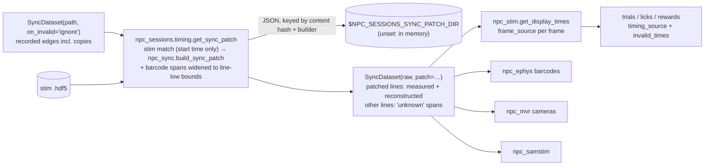

# Sync patching: P0 manifest, re-derived gates, `SyncPatch` (P1), patch-aware display times (P2), `npc_sessions.timing` (P3)

2026-11-17 · handoff: `notes/sync-patching-handoff.md` · plan: `outputs/sync-frame-timing-upgrade-plan.md`
Evidence: `experiments/sync-patch-manifest/` (scripts, logs, CSVs; see its README).
**Nothing is pushed.** All code is on local branches named `sync-patch`: npc_sync `7e64286`, npc_stim `7db2ce4`, npc_sessions branch `sync-patch` (`0fc22cd` + a report-only commit).

> **Update 2026-11-17 (handoff 2, phantom flicker): `outputs/phantom-flicker-report.md`.**
> - The box-1 photodiode failures below came from a pairing bug in `predict_diode_edges` (one frame late when the latency exceeds a refresh), not from phantom flicker. With the new block alignment, 53/53 box-1 spans with reconstructed vsyncs pass.
> - Phantom flicker is now removed by the patch in every session.
> - All `sync-patch` branches are merged into local `main` (not pushed).

## Summary

- **The P0 manifest covers all 2,971 sync files**: 2,945 on the Task 2 Pilot share, plus 26 npc_lims sessions whose raw data is only on S3. 152 files (5.1%) contain replayed buffers and 11 have timebase discontinuities.
- **Every block whose vsync count differs from its stim frames is classified**: 100 of 100 (`summary.log`).
- **Re-derived gates:**
  - Vsync per-gap residual: tightened from 0.5 to **0.2 ms**. The residuals are bimodal, and the second mode matches the unexplained ~0.4 ms-per-buffer residual seen in multi-run files.
  - Camera gate: 0.1 ms is kept.
  - Photodiode check: now tests the **0.5 s after** a span instead of 3 s.
  - Ephys barcode gate: proposed for the first time, at ≤0.5 ms for AP and NI-DAQ and ≤0.8 ms for LFP.
- **`SyncPatch` and the strict policy are in npc_sync.** Edge getters raise on unpatched invalid intervals. The library reproduces the prototype on the 7 local sessions: frame times are identical to <1 µs, the anchor residual is ≤0.047 ms, and the camera residual is ≤0.0321 ms.
- **npc_stim computes display times on a patched file.** Blocks the patch couldn't reconstruct are rejected, and each frame carries a `frame_source`.
- **npc_sessions.timing** builds, gates and caches the patch, and passes one patched `SyncDataset` to every consumer. It also:
  - adds `timing_source` to trials, licks and rewards
  - reconstructs licks and rewards inside replayed intervals
  - puts the replayed intervals in `invalid_times`
- **Validation against the NI-DAQ analog diode covers all 34 npc_lims ephys sessions from 2025 on that have reconcilable blocks.**
  - **Patched display times:** match in 35/35 replay windows. The worst error is 0.92 ms; the pre-window baseline goes up to 0.97 ms.
  - **Patched digital diode edges:** 34/35 pass. The one failure exceeds its limit by 0.06 ms.
- **Not done, or needing you:**
  - three decisions (below)
  - npc_mvr, npc_samstim and npc_ephys are not patch-aware yet
  - box-1 photodiode prediction (pre-2023 files) is rejected in 35 of 60 spans
  - releases and pushes

## P0 manifest

Code: `manifest.py` produces the per-file and per-block records, and `summarize.py` produces `manifest.csv` and `summary.log`. Each block is matched one-to-one to a stim file by start time only, so a count mismatch is detected rather than absorbed. In the old matcher it was `atol=1`.

| Population | Files | With invalid intervals | With discontinuities |
|---|---:|---:|---:|
| all | 2,971 | 152 | 11 (7 also have replays) |
| npc_lims-tracked | 465 | 58 | 5 |

Invalid data totals 737 s across the 152 files. The median per file is 1.5 s and the maximum is 134 s. 5 files have no usable vsync blocks and are listed in `summary.log`.

| Block class (gate 0.2 ms) | Blocks | Of which count ≠ stim | npc_lims-tracked |
|---|---:|---:|---:|
| clean | 5,795 | 0 | 2,291 |
| replay-reconcilable | 129 | 74 | 52 (51 sessions) |
| displaced (discontinuity in block or file) | 16 | 12 | 9 |
| unexplained | 13 | 9 | 2 |
| drop (located, ≈k × 0.5 s) | 4 | 4 | 2 |
| truncated (sync ended before stim) | 1 | 1 | 1 |
| no-stim / stim-without-block | 85 / 14 | n/a | 33 / 10 |

- **Accept criterion met.** All 100 matched blocks with count ≠ stim frames have a class (`summary.log`).
- **62 blocks keep the right count despite containing copies.** Count matching alone can't detect a replay.
- **Drops:** 840160_0428 at 2472.0 s (1.0 s), 715709_0808 (2.5 s), 717473_0916 (1.5 s) and 832032_0223 (1.5 s). Each is located with a 0.06–0.07 ms mean interval mismatch. Policy: rejected.
- **Stim-file events inside replayed spans (reconcilable blocks):** 175 licks, 6 rewards, 21 trial stim onsets, 56 RF-mapping stim onsets, 0 opto.
- **`unexplained` means a replay whose per-gap solve fails a gate, in a file without a detected discontinuity.** Example: 833388_20260420, one gap, residual −1.64 ms, balance −1. The plan says to reject these, and they are rejected.

## Re-derived gates

### Vsync per-gap residual (`gap_residuals.csv`)

| Population | Gaps | Median \|res\| | p95 | Max | Fit (ms per s of span) |
|---|---:|---:|---:|---:|---:|
| <20 runs, no discontinuity | 183 | 0.027 ms | 0.43 | 3.67 | −0.016 |
| ≥20 runs | 71 | 0.40 | 1.03 | 16.7 | −0.54 |
| files with discontinuities | 525 | 0.42 | 3.09 | 16.6 | −0.58 |

Histogram for the first row:

| \|residual\| (ms) | Gaps |
|---|---:|
| ≤0.05 | 144 |
| 0.05–0.1 | 15 |
| 0.1–0.15 | 1 |
| 0.2–0.5 | 16 |
| >0.5 | 7 |

- The 16 gaps between 0.2 and 0.5 ms come from 7 sessions. They often appear as ± pairs within one block (e.g. 798632_0829: +0.36 and −0.44 ms).
- Under the old 0.5 ms gate they passed. **New gate: 0.2 ms**, which sits between the two modes. That makes it *tighter* (4 blocks move from reconcilable to unexplained), and it doesn't widen anything.
- The second-best frame count is always ≥15.6 ms worse, so the 10 ms margin gate is kept.

**Finding (inference, not explained):**
- In multi-run and discontinuity files the residual scales with span length at about −0.55 ms per second, or about −0.3 to −0.4 ms per 0.5-s buffer.
- The camera lines in those same files interpolate across the same spans with a residual of ≤0.064 ms.
- So the sync sample timeline across those spans is consistent with a fixed-period clock. The vsync/stim mismatch has another source, which isn't identified.

### Camera integer-period residual (`summary.log`)

| Line type (<20 runs, no discontinuity) | Spans | p99 | Max | >0.1 ms |
|---|---:|---:|---:|---:|
| exposing | 1,274 | 0.054 ms | 0.151 | 6 |
| readout | 1,142 | 0.079 ms | 0.772 | 10 |

The distribution has no break near 0.1 ms, so the **0.1 ms gate is kept**.

**Update:** the period fit now excludes each camera's startup PWM section, the signature exposures (`startup_pwm_section`). Re-checked on all 9,692 camera line × span × edge cases (`camera_gate_check.log`):
- The one exposing failure it caused is fixed: 857681_20260720 eye cam, falling edges, −0.146 → −0.004 ms.
- Nothing else changes. The remaining 5 exposing failures are all in 813586_20251117 at 811–815 s, where all three cameras agree on a +0.1–0.15 ms excess, a timeline problem in a block that is already rejected. Spans that fail become 'unknown' for that line. `|gap/period − n|` reaches at most 0.009 for exposing lines and 0.046 for readout lines, against a gate of 0.01.

### Photodiode prediction (`diode_gate_check.log`)

Two corrections came from the data:
- **Splice event (`acceptance_local7.log`).** In 4 of 6 replays, the event at sample *start − 1* already carries the copy's state. The chance of an event at any given sample offset is about 0.8%. Every span now starts one sample early.
- **Polarity-dependent latency (`debug_diode.py`).** The digital diode's latency depends on polarity, e.g. 23.5 ms rising vs 19.8 ms falling in 862025_0805. Latency is now estimated per polarity.

The old post-span check compared the maxima of two 3-s windows, which fails by chance. In 9 of 95 box-3 spans the worst edge was 0.2–3 s after the span, while the first edges matched to ≤0.1 ms (`debug_diode3.py`). **New check:** the edges in the 0.5 s after the span must be within the 3-s pre-span maximum error + 0.5 ms. That threshold is unchanged.

| `diodeBoxFrameInterval` | Spans | Pass (new) | Pass (old) |
|---|---:|---:|---:|
| 3 (from file) | 95 | 93 | 86 |
| 1 (key absent, pre-2023 files) | 60 | 25 | 40 |

Box-1 spans are often rejected, mostly for polarity mismatches and unpairable pre-span edges. The new check rejects more of them than the old one did. Their display times stay unavailable, as they are on `main` today.

*Superseded (phantom-flicker report):* the box-1 rejections were caused by `predict_diode_edges` pairing each edge with the next frame. With box interval 1 the latency (19–26 ms) is longer than a refresh, so the pairing broke at every held frame. The same error inflated the box-1 baselines to 10–22 ms. Box-1 spans now use `align_diode_toggles` and `predict_box1_diode_edges`: 53/53 pass (`experiments/phantom-flicker/diode_gate_recheck.log`).

### Ephys barcode residual (first measurement; `ephys_barcode_robust.log`)

This covers 446 npc_lims ephys sessions: 5,504 devices in 431 sessions with data. Barcodes were paired by value, and the residual is what's left after a robust affine fit to all barcodes.

| Device (single-segment, clean files) | Devices | p99 max \|res\| | Max |
|---|---:|---:|---:|
| AP (30 kHz) | 2,100 | 0.315 ms | 4.70 |
| LFP (2.5 kHz) | 2,099 | 0.455 ms | 4.82 |
| NI-DAQ | 541 | 0.158 ms | 0.27 |

- **Proposed gate:** no pairing outliers, and robust max residual ≤0.5 ms (AP, NI-DAQ) or ≤0.8 ms (LFP). **136 of 5,504 devices fail, in 45 of 431 sessions.** Failures concentrate on `Neuropix-PXI-116.ProbeD` (61 devices) and a few other probes. In these devices the probe clock isn't a single affine map of sync time, even in clean sync files.
- **The current alignment** (npc_ephys `get_probe_time_offset`, which uses the first and last matched barcode) is >1 ms off the robust fit somewhere in the recording for **104 devices in 43 sessions**. They fall into three groups:
  - **75 devices in 38 sessions** whose probe clock isn't one affine map of sync. These are mostly ProbeD on PXI-116 and PXI-109. The error reaches 321 ms (850217_2026-04-02).
  - **12 single-segment devices** whose robust residual is itself 1–5 ms.
  - **17 devices off by 30–66,000 s.** The first/last-barcode pairing is wrong:
    - 751595_2024-11-20, ProbeB-LFP and ProbeD-LFP
    - 837959_2026-04-01, ProbeC-LFP
    - 649944_2023-02-27, ProbeE-LFP
    - 660023_2023-08-08, all 13 devices; that sync recording is truncated
- **Caveat.** I reproduced the npc_ephys calls (`match_barcodes` → `linear_transform_from_intervals`) but did **not** check these against the units and LFP timestamps that npc_sessions actually writes. The sync file was also chosen per session key from the share.
- **Not applied in code.** This belongs to the npc_ephys `match_barcodes` and piecewise work (plan P2), which is outside this handoff.

## P1: npc_sync `SyncPatch` (branch `sync-patch`)

New module `npc_sync.patch`:
- `solve_vsync_gaps` / `reconcile_vsyncs`: the per-gap solve (n = argmin |Δt_sync − Δt_stim(n)|, interpolated between anchors), with gates and block balance.
- `interpolate_periodic_edges`: cameras.
- `predict_diode_edges`: the photodiode.
- `locate_drop` / `reconcile_drop`: ported, but the policy for drops is still to reject.
- `SyncPatch` / `SpanPatch`: per line and per span, either `reconstructed` (with `method`, `error_bound_sec` and anchor diagnostics) or `unknown`. Keyed to `SyncDataset.content_hash` and the builder string. JSON save/load.
- `build_sync_patch`.

In `SyncDataset`:
- `SyncDataset(path, patch=…, on_invalid='raise'|'mask'|'ignore')`. The default is **raise on any edge query on a file with invalid intervals** (P0 hotfix).
- A supplied patch always applies to the lines it covers.
- `get_edge_sources` and `get_unknown_intervals` are new.
- Gap-aware blocks: `reshape_into_blocks(bridge=…)` doesn't split at unknown spans.

| Check (`acceptance_local7.log`) | Result |
|---|---|
| A1 all 6 replay blocks reconcile; max anchor residual ≤0.05 ms | 6/6, max 0.047 ms (847958) |
| A2 per-frame times = prototype `reconcile_replay` (single-gap blocks) | 6/6, max diff 0.000 µs, same sources |
| A3 camera exposing lines: count = copies, residual as in the prototype (≤0.032 ms) | 22/22, max 0.0321 ms |
| A4 patched vsync blocks have exactly the stim frame count | 42/42 |
| A5 unpatched file raises on every line; patched file raises on none; mask drops copies | 24/24 |
| A6 JSON round trip identical on all 32 bits | 6/6 |
| A7 predicted digital diode vs analog diode in the window ≤ pre-window max + 0.5 ms | 5/5, window max 0.36 ms |
| A8 840160: `timebase_discontinuities` flags it; drop located at 2472.0 s | 2/2 |
| Unit tests (npc_sync `tests/test_patch.py`, plus doctests, replay and discontinuity tests) | 47 passed. `test_strict_policy_raises` fails under 0.3.1, which returns the copies (checked) |

## P2: npc_stim patch-aware display times (branch `sync-patch`)

`get_display_times` accepts a patched file. Changes:
- Blocks overlapping an 'unknown' vsync or diode span become `unavailable` with a reason.
- A new field, `BlockDisplayTimes.frame_source`, marks interpolated frames.
- Files with discontinuities are still refused.

| Check (`p2_display_times_local.log`) | Result |
|---|---|
| B1 unpatched replay file and 840160 still raise | 7/7 |
| B2 patched blocks: photodiode, n = stim frames | 6/6 |
| B3 blocks away from spans: byte-identical to the baseline | 30/30 |
| B4 `frame_source` = interpolated vsync ∪ reconstructed-diode span | 6/6 |
| B5 toggle-frame display times vs analog diode in window ≤ pre + 0.5 ms | 5/5, window max 0.36 ms |

The npc_stim test suite passes (12 passed, 1 xfailed), with 3 new synthetic tests.

The baseline for 847958_0413 is notable. Indexing the raw copies gave `photodiode` display times for the whole task block (the old `atol=1` case), and every frame after 5707.5 s was one off. The patched result is correct.

## P3: `npc_sessions.timing` (branch `sync-patch`)

What `src/npc_sessions/timing.py` and `sessions.py` do:
- **Session properties:** `_raw_sync_data`, `sync_patch`, `sync_data` (patched, strict), `sync_timing_report` (status per block: clean, patched or rejected, with gate values) and `stim_frame_time_sources`.
- **Consumers:** display times, ephys timing, rewards and quiescent violations all receive the one patched `SyncDataset`.
- **`invalid_times`:** gets one entry per replayed interval, naming the unknown lines and the reconstructed ones.
- **`timing_source` columns:**
  - trials: `measured` or `patched`
  - licks: `sync` or `stim_frame`. Reconstructed licks come from `lickFrames` at the midpoint of the frame interval before the read, so they are ±½ frame; duration is NaN.
  - rewards: `sync` or `stim_frame`. Reconstructed rewards use the flip time plus the session's median measured latency; duration is NaN.
- **Barcode unknown spans** are widened by 2 s, out to bounds where the line is low. Without that, npc_ephys decoding failed with unequal on/off counts in 840160_0429 and 854390_0423. Found in step 6.
- **Patch cache:** JSON in `$NPC_SESSIONS_SYNC_PATCH_DIR` if set. It is unset in every run here, so nothing was written to S3.

| Check (`p3_session_check*.log`, 5 real sessions) | Result |
|---|---|
| C1 patch applied; no edge query raises | 10/10 |
| C2 replay blocks `patched` with photodiode display times; others `clean` | 30/30 |
| C3 `invalid_times` covers every replayed interval | 6/6 |
| C4 trials built; none overlaps `invalid_times`; `timing_source` present | 5/5 |
| C5 reconstructed licks only inside unknown lick spans (839146_0518: 6, which matches `lost_events.log`) | 5/5 |
| C6 reconstructed rewards only inside unknown reward spans (835598_0227, 837959_0402: 1 each) | 5/5 |
| C7 interpolated frames reported per stim | 5/5 |
| `tests/test_timing.py` (4, synthetic: licks ≤½ frame, reward latency, cache reuse, barcode pairing). The barcode test fails without the fix (checked) | 4 passed |
| npc_sessions suite, branch libraries (`npc_sessions_tests.log`) | 20 passed, 2 failed |

The 2 failures are `test_opto` with `ignore_stim_errors=False` for 636766_2023-01-23. They are **not a regression**:
- On `main` with the released libraries, the same tests fail because npc_stim refuses the whole file.
- Now only that session's RF-mapping block is rejected. It is a box-1 diode span that fails the gate.

## Step 6: analog validation (2025+)

Covered: every npc_lims ephys session from 2025-01-13 on with a reconcilable block (34 sessions, 35 spans). I compared NI-DAQ AI0 against the patched data, reading only [span − 4 s, span + 3 s] from S3 (`analog_windows_*.py`).

| Check | Result |
|---|---|
| V1 patched digital diode edges in the window ≤ pre-window max + 0.5 ms | 29/30, plus 5/5 local (A7) |
| V2 patched toggle-frame display times, same rule | 30/30, plus 5/5 local (B5); window max 0.92 ms (pre max 0.97 ms) |
| V3 one analog transition ↔ one patched edge inside the span | 30/30 |

- **5 sessions couldn't be located on S3 by this pipeline.** They are 836629_0430, 839146_0518, 856847_0602, 856847_0604 and 862025_0805, and they are the local sessions already validated against their analog npz.
- **The V1 failure** is 841308_20260511 (1089.5–1091.5 s): 0.67 ms against the 0.61 ms allowed. The display times for that span pass.
- **V3 was adjusted after the first run.** It initially failed 1 span (837959_0331) because the digital edge of the last transition fell just after the span end, while V1 showed every transition within 0.14 ms. Its digital search now extends 5 ms past the span, as disclosed in the script.
- Validation covers 1,036 analog transitions inside windows.

## Defaults I took (reversible), and the decisions still needed

1. **Licks (decision needed).** I didn't keep any trial that overlaps a replayed interval: they are excluded through `invalid_times`, because sound, opto and lick edges are all unknown there. Reconstructed licks appear only in the licks table, flagged. To keep those trials you'd need to accept ±8.3 ms licks *and* have a non-sync source for sound and opto onsets.
2. **Vsync count ≠ stim frames with no explained fault (decision needed).** Unchanged: npc_stim returns `unavailable` plus a reason, and `sync_timing_report` marks the block `rejected`. Nothing raises.
3. **Push and release (decision needed).** Nothing is pushed. The order must be npc_sync, then npc_stim (raise its `npc-sync` floor), then npc_sessions (floors for both). On the npc_sessions branch, `sessions.py` requires the unreleased npc_sync, because it passes `SyncDataset(on_invalid=…)`. The strict default in npc_sync is breaking for np_services rig QC and npc_sessions_cache on the ~5% of files with replays. That's intended by the plan, but it needs a version bump and a note.
4. **Gates.** The 0.2 ms vsync gate and the 0.5-s diode check are applied on the npc_sync branch. The ephys gate is only proposed.

## Not done / blocked

- **npc_mvr:** not patch-aware. Camera exposing spans that fail the gate (6 of 1,274) become unknown, and npc_mvr's existing <20-frame tolerance still applies.
- **npc_samstim:** the onset search is unbounded. Trials in replayed intervals are excluded, so the wrong onsets there are dropped.
- **npc_ephys:** barcodes in replayed intervals are masked by the patch, but the first/last-barcode fit is unchanged. See the 104 devices above.
- **Box-1 photodiode prediction (pre-2023 files).** 35/60 spans are rejected. A box-1-specific method is needed. *Done 2026-11-17: 53/53 spans with reconstructed vsyncs pass; the other 7 fail the vsync gate (`outputs/phantom-flicker-report.md`).*
- **Multi-run and displaced files stay rejected**, as the plan requires. The −0.55 ms/s residual is unexplained.
- **Plan leftovers:**
  - stim matcher exactness in npc_stim (`atol=1`); the manifest and timing use an exact matcher of their own
  - end-of-block truncation
  - NWB/cache regeneration
  - the upstream DAQ buffer fix (MPE)
  - cache cleanup
- **Not committed (too large):** `experiments/sync-patch-manifest/ephys_barcode_residuals.jsonl` (21 MB), kept on disk. Analog window files are in `C:/data/t2p_qc/analog_windows/`.

## Close-out (2026-11-18)

Decisions from `notes/sync-patching-handoff-2.md` applied in npc_sessions (local `main`, not pushed):

- **Decision 1 (licks/trials):** replayed intervals are no longer `invalid_times`. Trials overlapping them are kept with `timing_source='patched'`. Reconstructed licks stay in the licks table only. In the trials tables, events whose sync line is unknown in the interval are NaN: `response_time` (if the lick line is unknown in the response window before the first measured lick), sound onsets/offsets, and opto onsets/offsets (DynamicRouting1, RFMapping, OptoTagging). OptoTagging rows with an unknown onset are omitted from the intervals table (logged). Epochs overlapping a replay get the tag `replayed_sync` and a note. This also closes the "npc_samstim onset search is unbounded" item for npc_sessions: such onsets are now masked instead of dropped with the trial.
- **Patch cache:** written by default to `s3://aind-scratch-data/dynamic-routing/cache/sync_patches/<session>_<hash12>.json` when AWS credentials are available. The JSON adds `dependency_versions` (npc_sessions, npc_sync, npc_stim). A patch is rebuilt and overwritten when the builder or any version differs.
- **Checks:** D1–D7 pass on the 5 replay sessions (`experiments/sync-patch-manifest/p4_replay_trials_check.log`). 5 trials recovered in 4 sessions (2+1+1+1) compared with `p3_session_check_final.log`. npc_sessions suite: 49 passed, 2 skipped, 1 failed. The failure is `test_surface_recording` ("703880_2024-04-17_1 has no main raw data assets", npc_lims/Code Ocean lookup), which also fails on `HEAD`.
- **Decision 4 (ephys gate):** already in npc_ephys 0.1.52 (`DEFAULT_MAX_RESIDUAL_MS` = 1 ms; an LFP stream fails with its AP stream). Nothing changed here.

## Sources

- Handoff: `notes/sync-patching-handoff.md`. Plan: `outputs/sync-frame-timing-upgrade-plan.md`.
- Evidence: `experiments/sync-patch-manifest/` (`summary.log`, `gates.json`, `manifest.csv`, `acceptance_local7.log`, `p2_display_times_local.log`, `p3_session_check*.log`, `diode_gate_check.log`, `ephys_barcode_robust.log`, `analog_windows_compare.log`).
- Prototype and earlier evidence: `../npc_sync/experiments/vsync-frame-count/repair.py`, `validate_repair.log`; `experiments/sync-frame-timing/` (`multi_gap_check.log`, `camera_gap_check2.log`, `lost_events.log`, `lick_count_check.log`, `event_latency_check.log`).
- Analog channel and diode conventions: `outputs/display-times-analog-validation.md`. npc_stim display-time fixes: `outputs/display-times-issues.md`.
